<!-- Memoria del TFM. Estructura idéntica a la del TFM de ejemplo del mismo máster
     (TFM-VIU-main/doc/memoria.tex): portada, agradecimientos, índices, resumen, 1 Introducción, 2 Estado del arte,
     3 Marco teórico, 4 Objetivos, 5 Metodología y desarrollo, 6 Resultados y discusión, 7 Conclusiones,
     8 Limitaciones y perspectivas de futuro, lista de acrónimos, referencias y apéndices.
     Formato final (guía 09MIAR 2026-27): plantilla del Aula, Arial/Helvética 11 pt, interlineado 1,5, márgenes 3 cm,
     40–80 páginas sin anexos, APA, tercera persona impersonal. Las cifras proceden de la bitácora del proyecto (Apéndice A). -->

<div align="center">

**UNIVERSIDAD INTERNACIONAL DE VALENCIA**

**Máster Universitario en Inteligencia Artificial**

**Trabajo Fin de Máster (09MIAR)**

# Predicción de la Dirección de Bitcoin utilizando una Red Neuronal Espigante de Segmentos Temporales y Aprendizaje Automático

**Autor:** Lucas Ivan Tamara Trejo

**Director/a:** *pendiente de asignación*

**Convocatoria:** curso abril 2026-2027

**Octubre de 2026** *(borrador)*

</div>

---

## Agradecimientos

*(Apartado opcional, a redactar por el autor.)*

---

## Índice general

- Resumen · Abstract
- 1. Introducción
- 2. Estado del arte
  - 2.1. Predicción de Bitcoin con aprendizaje automático
  - 2.2. Problemas de evaluación en la literatura
  - 2.3. Computación de reservorio y redes espigantes en finanzas
  - 2.4. Neuronas multiescala para series temporales: TS-LIF
  - 2.5. Líneas de investigación seleccionadas
- 3. Marco teórico
  - 3.1. Aprendizaje automático supervisado para series temporales
  - 3.2. Neuronas espigantes: de LIF a TS-LIF
  - 3.3. Computación de reservorio
  - 3.4. Árboles de decisión, bosques aleatorios y gradient boosting
  - 3.5. Métricas de evaluación
  - 3.6. Inferencia estadística con dependencia temporal
- 4. Objetivos
  - 4.1. Objetivo general
  - 4.2. Objetivos específicos
- 5. Metodología y desarrollo
  - 5.1. Datos utilizados
  - 5.2. Diseño experimental
  - 5.3. Red propuesta: E20-ALB
  - 5.4. Variante con atención: TIA-LIF
  - 5.5. Modelos de referencia
  - 5.6. Evaluación estadística
  - 5.7. Medición del coste computacional
  - 5.8. Implementación y reproducibilidad
  - 5.9. Consideraciones éticas y legales
- 6. Resultados y discusión
  - 6.1. Validación del protocolo
  - 6.2. Experimentación con datos sintéticos
  - 6.3. Experimentación con Bitcoin y otros activos
  - 6.4. Discusión
- 7. Conclusiones
- 8. Limitaciones y perspectivas de futuro
- Lista de acrónimos
- Referencias bibliográficas
- Apéndice A. Registro de preregistros y resultados
- Apéndice B. Reproducibilidad
- Apéndice C. Protocolo de la prueba final congelada
- Apéndice D. Nomenclatura de los modelos
- Apéndice E. Declaración de uso de sistemas de IA

## Índice de figuras

1. Respuesta al impulso y en frecuencia de la neurona TS-LIF
2. Arquitectura de E20-ALB
3. Confirmación en bancos sintéticos nunca vistos
4. Cambio de régimen de volatilidad
5. E20-ALB frente a TIA-LIF en datos sintéticos
6. Predictibilidad de la dirección de BTC por escala temporal
7. BTC a 2 horas: AUC por modelo
8. BTC a 2 horas: diferencias pareadas de E20-ALB con cada rival
9. BTC a 2 horas en tres periodos
10. Réplica en cuatro series
11. Coste computacional por predicción
12. Comparador oblicuo frente a árboles de decisión

## Índice de tablas

1. Síntesis del estado del arte · 2. Conjuntos de datos · 3. Bancos sintéticos · 4. Entradas de los modelos · 5. Controles del protocolo · 6. Ablación de MDHS-SNN a E20 · 7. Confirmación sintética · 8. Ranking sintético · 9. E20-ALB frente a TIA-LIF · 10. Predictibilidad por escala · 11. BTC 2 h · 12. Diferencias pareadas en BTC 2 h · 13. BTC en periodos anteriores · 14. Réplica en otros activos · 15. Información adicional · 16. Alta frecuencia y modificaciones teóricas · 17. Mercados tradicionales · 18. Predicción selectiva · 19. Coste computacional · 20. Fuga en TIA-LIF · 21. Respuesta a las hipótesis

## Índice de algoritmos

1. Simulación del reservorio E20-A1 · 2. Entrenamiento y predicción de E20-ALB · 3. Bootstrap de bloques emparejado para la diferencia de AUC

---

## Resumen

Este trabajo evalúa si una red neuronal espigante basada en la neurona de dos compartimentos TS-LIF (Feng et al., 2025) aporta información para predecir la dirección del precio de Bitcoin (BTC) más allá de los modelos de aprendizaje automático habituales. **El trabajo se basa en una línea de investigación previa del propio autor**, desarrollada durante 2026, en la que se construyeron la red de reservorio MDHS-SNN, su versión simplificada E20 y una variante con atención, TIA-LIF; este TFM formaliza, amplía y evalúa ese trabajo. El modelo propuesto, **E20-ALB**, es un reservorio de 1 000 neuronas TS-LIF sin recurrencia cuyos 3 001 estados se leen con un bosque aleatorio; se evalúa también **E20-A0C**, que añade 62 indicadores técnicos como entradas. La evaluación es preregistrada y cronológica, con placebos, réplica y rivales con la misma información. En series sintéticas con señal conocida, E20-ALB supera a un bosque aleatorio con entradas estándar en 5 de 9 bancos y a TIA-LIF en 4 de 4, pero no a modelos con características multiescala equivalentes. En BTC solo se detectó señal de dirección entre 1 minuto y 2 horas. A 2 horas todos los modelos razonables alcanzan un AUC de 0,53–0,58 según el periodo y ninguna versión de E20 supera de forma significativa al gradient boosting ni a la regresión logística con la misma información: E20-ALB es la E20 con mayor AUC en 2021–2024 (0,570) y E20-A0C en 2024–2026 (0,546). La predictibilidad decae con el tiempo y el patrón se repite en Ether y en oro tokenizado. Con entrada de 5 minutos, E20 no superó a rivales equiparados y tres cambios de dinámica o lectura no pasaron el cribado; un límite de información en el precio es la explicación más compatible, no un techo demostrado. La confirmación con datos nunca utilizados queda definida y pendiente.

**Palabras clave:** redes neuronales espigantes, TS-LIF, computación de reservorio, Bitcoin, predicción de dirección, bosque aleatorio, validación cronológica, preregistro.

## Abstract

This work assesses whether a spiking neural network built on the two-compartment TS-LIF neuron (Feng et al., 2025) adds information to predict the direction of the Bitcoin (BTC) price beyond standard machine-learning models. **It builds on the author's own prior research carried out during 2026**, which produced the MDHS-SNN reservoir, its simplified version E20 and an attention variant, TIA-LIF; this thesis formalises, extends and rigorously evaluates that work. The proposed model, **E20-ALB**, is a 1,000-neuron TS-LIF reservoir without recurrence whose 3,001 states are read out by a random forest; **E20-A0C**, which adds 62 technical indicators as inputs, is also evaluated. Evaluation is pre-registered and chronological, with placebos, replication on several assets and rivals fed the same information. On synthetic series with known signal, E20-ALB outperforms a random forest with standard inputs in 5 of 9 benchmarks and TIA-LIF in 4 of 4, but not models given equivalent multi-scale features. On BTC, a direction signal was detected only between 1 minute and 2 hours. At 2 hours every reasonable model reaches an AUC of 0.53–0.58 depending on the period, and no E20 version significantly beats gradient boosting or logistic regression with the same information: E20-ALB is the E20 with the highest AUC in 2021–2024 (0.570) and E20-A0C in 2024–2026 (0.546), with no significant difference between them. Predictability decays over time and the pattern repeats on Ether and tokenised gold. With 5-minute input, E20 did not beat matched rivals, and three dynamics or readout changes did not pass screening; an information limit in the price is the most compatible explanation, not a proven ceiling. Confirmation on never-used data is specified and pending.

**Keywords:** spiking neural networks, TS-LIF, reservoir computing, Bitcoin, direction forecasting, random forest, chronological validation, pre-registration.

---

## 1. Introducción

La predicción de precios de criptomonedas se ha convertido en uno de los problemas más publicados del aprendizaje automático aplicado a las finanzas. Bitcoin (BTC), el activo de mayor capitalización, cotiza las 24 horas, dispone de datos públicos de alta frecuencia desde hace casi una década y tiene una volatilidad muy superior a la de los mercados tradicionales. Estas características lo convierten en un banco de pruebas atractivo para cualquier técnica de series temporales. Sin embargo, buena parte de la literatura informa resultados que no resisten una evaluación cuidadosa: se predice el **nivel** del precio, donde el valor de ayer ya explica casi toda la variación; no se compara con un referente ingenuo; se usan particiones aleatorias que filtran información del futuro; o se elige el mejor modelo mirando el conjunto de prueba. Revisiones recientes concluyen que la necesidad principal del campo no son más modelos sino mejor evaluación (Baquero, 2026), y los trabajos con protocolo estricto obtienen resultados negativos o muy modestos (Sánchez Zurdo, 2022; Berger y Koubová, 2024).

En paralelo, las **redes neuronales espigantes** (SNN, por sus siglas en inglés) han ganado interés como modelos bioinspirados: sus neuronas integran la entrada en el tiempo y se comunican mediante pulsos discretos, lo que les confiere una dinámica temporal propia y un potencial de bajo consumo en hardware neuromórfico (Sabbella et al., 2025). Dentro de esta familia, la neurona **TS-LIF** (Feng et al., 2025), presentada en la conferencia ICLR 2025, añade a la neurona clásica de integración y disparo con fuga (LIF) un segundo compartimento: una dendrita lenta y un soma rápido que separan las componentes de baja y alta frecuencia de la serie. En sus experimentos, con datos de tráfico, energía solar y electricidad, supera a las SNN basadas en LIF. Esos conjuntos de datos tienen una estacionalidad muy marcada. Queda abierta la pregunta de si esa capacidad multiescala sirve en una serie financiera casi impredecible.

El problema que se aborda es, por tanto, **determinar si un modelo basado en la neurona TS-LIF extrae de la serie de precios de BTC información sobre la dirección del siguiente movimiento que no extraen los modelos de aprendizaje automático habituales**, cuando todos reciben la misma información y se evalúan con el mismo protocolo cronológico. Se trata de un problema de clasificación binaria (sube o baja) sobre una serie temporal no estacionaria con una relación señal/ruido muy baja. Se elige la **dirección** y no el nivel porque no hereda la autocorrelación trivial del precio y porque un acierto superior al azar en la dirección es la condición mínima para que una predicción tenga interés práctico.

**Trabajo previo en el que se basa este TFM.** Siguiendo la guía de la asignatura, se declara explícitamente que este trabajo se apoya en una línea de investigación previa del propio autor, desarrollada entre marzo y octubre de 2026 y versionada en un repositorio git propio: (i) **TIA-LIF**, una red de neuronas TS-LIF con atención temporal entrenada por retropropagación, cuyos primeros resultados (87–94 % de acierto diario) resultaron estar inflados por una fuga de información que el propio autor detectó y corrigió; (ii) **MDHS-SNN**, un reservorio de 1 000 neuronas TS-LIF con plasticidad sináptica; y (iii) **E20**, su versión simplificada obtenida por ablación sistemática. Las aportaciones propias de este TFM sobre esa base son la variante sin recurrencia con lectura de bosque aleatorio (**E20-ALB**), el protocolo de evaluación preregistrado, la comparación con modelos de aprendizaje automático y con TIA-LIF corregida, la réplica en varios activos y escalas temporales, y el análisis matemático que explica los resultados.

Las principales aportaciones del trabajo son seis: una evaluación preregistrada de un reservorio TS-LIF para la dirección de criptomonedas; el modelo E20-ALB, que supera a un bosque aleatorio con entradas estándar y a la variante con atención en datos con estructura conocida; un mapa de la predictibilidad de BTC en 13 escalas temporales; una explicación mecanística de cuándo la neurona TS-LIF ayuda y cuándo no; un estudio de caso de fuga de información en una SNN; y un resultado negativo cuantificado sobre el techo de predictibilidad de la dirección a 1–2 horas. El alcance se limita a la capacidad predictiva: no se afirma utilidad económica, porque los costes de transacción no forman parte de la pregunta principal.

La organización del documento es la siguiente: el capítulo 2 revisa el estado del arte; el capítulo 3 presenta el marco teórico (aprendizaje supervisado temporal, neuronas espigantes, reservorios, bosques aleatorios, métricas e inferencia con dependencia temporal); el capítulo 4 plantea los objetivos; el capítulo 5 describe los datos, la red propuesta, los modelos de referencia y el protocolo; el capítulo 6 presenta y discute los resultados; el capítulo 7 recoge las conclusiones y el capítulo 8 las limitaciones y las perspectivas de futuro.

---

## 2. Estado del arte

En este capítulo se revisan la predicción de Bitcoin con aprendizaje automático, los problemas de evaluación más frecuentes en esa literatura, las aplicaciones de la computación de reservorio y de las redes espigantes en finanzas, y la neurona TS-LIF. El capítulo termina con las líneas de investigación seleccionadas para este trabajo.

### 2.1. Predicción de Bitcoin con aprendizaje automático

La literatura sobre predicción de criptomonedas abarca desde modelos econométricos clásicos (ARIMA, GARCH) hasta redes profundas (LSTM, GRU, redes convolucionales y transformadores). Akyildirim et al. (2021) predicen el signo del retorno de doce criptomonedas con máquinas de vectores soporte, regresión logística, redes neuronales y bosques aleatorios, a escalas diaria y de minutos; obtienen aciertos de hasta el 69 %, pero esa cifra corresponde a la mejor de muchas combinaciones evaluadas sobre periodos de prueba cortos (del orden de 63 días), lo que exige cautela por selección. Berger y Koubová (2024) comparan modelos econométricos de series temporales con algoritmos de aprendizaje automático para los retornos de BTC y no encuentran una superioridad robusta de los segundos. Kraehenbuehl y Osterrieder (2022) analizan la hipótesis de eficiencia de mercado para BTC con redes neuronales y datos diarios desde 2014 junto a índices bursátiles, divisas, bonos y metales, sin hallar ineficiencias explotables.

En el ámbito de la volatilidad, donde sí existe estructura (agrupamiento de la volatilidad), Shen, Wan y Leatham (2021) comparan GARCH con redes recurrentes, y Audrino y Chassot (2024) muestran que el modelo autorregresivo heterogéneo de volatilidad realizada (HAR) bien reestimado, con una ventana móvil, es muy difícil de batir por aprendizaje automático: el protocolo de reestimación importa tanto como el modelo.

En el entorno académico hispanohablante abundan los trabajos de fin de grado y máster sobre el tema. Sánchez Zurdo (2022) diseña y optimiza una LSTM para las variaciones de BTC a corto plazo y la compara con tres referentes (variación nula, media ingenua y regresión lineal); su conclusión es que la red no supera al retorno cero. García-Ramos Lucero (2023), en una tesis doctoral sobre las criptomonedas como clase de activo, aplica ARIMA y LSTM y obtiene resultados equivalentes a un paseo aleatorio. Otros trabajos, como López-García (2023) o Hernández Hernández y Forero Criollo (2023), informan errores muy bajos al predecir el nivel del precio, métrica que, como se discute a continuación, no constituye evidencia de capacidad predictiva.

### 2.2. Problemas de evaluación en la literatura

Baquero (2026) revisa la evidencia revisada por pares sobre la predicción de BTC y concluye que, en horizontes de 1 a 6 meses, ningún estudio supera de forma robusta al referente «el precio de hoy» en varios regímenes de mercado; que la predictibilidad diaria, si existe, es pequeña y puede no sobrevivir a los costes; y que el campo necesita mejores prácticas: referentes ingenuos, evaluación en varios regímenes, pruebas de Diebold–Mariano y conjuntos de confianza de modelos. De la literatura revisada se extraen cuatro errores recurrentes:

1. **Predecir el nivel en lugar del cambio.** Un modelo que copia el precio de ayer obtiene un R² cercano a 1; un R² alto en el nivel no indica capacidad predictiva. En Hernández Hernández y Forero Criollo (2023) se informa incluso un R² = 1, compatible con una fuga.
2. **Ausencia de referente ingenuo** o de modelos simples bien ajustados.
3. **Particiones no cronológicas** o transformaciones ajustadas con toda la serie, que filtran información del futuro.
4. **Selección sobre el conjunto de prueba:** elegir hiperparámetros, variables o el mejor de muchos modelos mirando el test, y presentar esa cifra como rendimiento esperado.

Este trabajo adopta salvaguardas explícitas frente a los cuatro: objetivo de dirección, rivales simples con la misma información, partición cronológica con todas las transformaciones ajustadas solo con el entrenamiento, y preregistro de hipótesis antes de ejecutar cada experimento.

### 2.3. Computación de reservorio y redes espigantes en finanzas

La computación de reservorio (Jaeger, 2001; Maass et al., 2002) proyecta la serie de entrada a un sistema dinámico fijo de alta dimensión y entrena solo una lectura, normalmente lineal. Zhang y Vargas (2023) revisan sus aplicaciones y señalan que el radio espectral menor que 1 no es necesario ni suficiente para un buen rendimiento, que el rendimiento se satura con el tamaño del reservorio y que las variantes profundas (DeepESN) amplían su capacidad. Domingo Colomer (2023) estudia reservorios clásicos y cuánticos, propone la métrica de acierto direccional (MDA) para series y analiza el ensamble de reservorios, observando que los reservorios de nueva generación (NG-RC) rinden de forma similar a referentes lineales con retardos.

Los precedentes en finanzas y criptomonedas son escasos y su evaluación suele ser débil:

- **Sharma et al. (2025)** aplican redes de estado de eco a BTC y afirman superar a XGBoost y al método ingenuo en el precio de cierre del día siguiente, con una ventaja mayor en los periodos más caóticos según el exponente de Lyapunov. Evalúan el nivel del precio con ajuste fino de hiperparámetros.
- **Kenny (2020)** compara reservorio, aprendizaje profundo y aprendizaje automático en BTC y ETH a corto, medio y largo plazo, también sobre el nivel.
- **He (2023)** aplica reservorios a la predicción de alfa en el mercado de divisas en colaboración con un banco, y **Li et al. (2025)** utilizan reservorios cuánticos para la volatilidad realizada; en este último se informa el mejor de 100 reservorios, lo que introduce un sesgo de selección.
- **Ezinwoke y Rhodes (2025)** emplean SNN para movimientos de precio en datos de alta frecuencia; **Walugembe et al. (2026)** proponen redes recurrentes espigantes bioinspiradas con optimización evolutiva para criptomonedas no estacionarias; **Gao, Luk y Weston (2021)** usan SNN con plasticidad STDP para detectar cuándo habrá movimientos fuertes en petróleo y oro.

Ninguno de estos trabajos combina tres condiciones: objetivo de **dirección**, comparación con modelos que reciben **la misma información** y **preregistro** con placebos y réplica en otros activos.

### 2.4. Neuronas multiescala para series temporales: TS-LIF

Lv et al. (2024) establecen un marco de predicción de series temporales con SNN: codificadores delta y convolucional, versiones espigantes de TCN, GRU y transformadores, y la alineación del paso temporal de la serie con varios micro-pasos de simulación. Sobre ese marco, Feng et al. (2025) proponen **TS-LIF**, una neurona de dos compartimentos con una dendrita lenta (α₁ ≈ 0,95) y un soma rápido (α₂ ≈ 0,05), un atajo de la corriente de entrada al soma, resets adaptativos y una salida que mezcla espigas dendríticas y somáticas. Demuestran analíticamente que la dendrita actúa como filtro paso bajo y el soma como filtro paso alto; empíricamente, TS-LIF supera a las neuronas TC-LIF, LM-H y CLIF en cuatro conjuntos de datos, es más robusta cuando faltan datos (por ejemplo, con un 80 % de datos ausentes en Electricity el R² pasa de 0,745 a 0,939 con un modelo GRU), recuerda mejor en una tarea XOR con retardo y reduce entre un 64 % y un 74 % la energía teórica estimada a 45 nm frente a redes artificiales equivalentes.

Tres limitaciones del artículo son relevantes para este trabajo: (i) los conjuntos de datos tienen estacionalidad fuerte y R² alto; (ii) se predice el valor de la serie, no su dirección; y (iii) el código oficial difiere de las ecuaciones publicadas (decaimientos libres sin restricción, mezcla graduada por canal y reset dendrítico fijo). En este trabajo se usa la versión de las ecuaciones del artículo.

### 2.5. Líneas de investigación seleccionadas

La Tabla 1 de síntesis resume el vacío detectado.

**Tabla 1.** Síntesis del estado del arte y vacío que cubre el trabajo.

| Línea | Qué existe | Qué falta |
|---|---|---|
| Aprendizaje automático para BTC | Muchos modelos; los resultados honestos son modestos o nulos | Evaluar modelos bioinspirados con el mismo rigor |
| Reservorios y SNN en finanzas | Precedentes con nivel de precio, una partición o selección sobre el test | Dirección, mismas entradas, preregistro, réplica |
| TS-LIF | Neurona multiescala eficaz en series estacionales | Evidencia en series financieras de baja señal y uso como reservorio |

A partir de esta revisión se seleccionan tres líneas: (1) usar la neurona TS-LIF como unidad de un **reservorio** con lectura entrenada, lo que reduce el coste de entrenamiento y aísla la contribución de la representación; (2) comparar con **bosques aleatorios, gradient boosting y regresión logística** que reciben la misma información, además de con la variante con atención; y (3) adoptar un **protocolo preregistrado** con controles sintéticos, placebos y réplica en varios activos.

---

## 3. Marco teórico

### 3.1. Aprendizaje automático supervisado para series temporales

En aprendizaje supervisado se dispone de pares $(\mathbf{x}_t, y_t)$ y se ajusta una función $f$ que minimiza un error esperado sobre datos nuevos. En este trabajo $\mathbf{x}_t$ resume la historia de precios hasta el instante $t$ e $y_t\in\{0,1\}$ indica si el retorno de la barra siguiente es positivo: es un problema de **clasificación binaria**. Los modelos producen una probabilidad $\hat p_t = P(y_t=1\mid\mathbf{x}_t)$.

En series temporales la validación debe respetar el orden: si el modelo se entrena con observaciones posteriores a las que predice, aprende patrones del futuro y su rendimiento se sobreestima. Se utiliza una **partición cronológica**: el 70 % inicial de la serie para entrenamiento y el 30 % final para prueba. Cualquier transformación aprendida (escalado, selección de variables, lectura) se ajusta solo con el entrenamiento. Además, las variables de entrada deben ser **causales**: su valor en $t$ solo puede depender de información disponible al cierre de $t$.

La serie de retornos de BTC presenta tres rasgos que condicionan el diseño: media cercana a cero y autocorrelación muy débil (la dirección es casi impredecible), agrupamiento de la volatilidad (la magnitud sí es parcialmente predecible) y cambios de régimen (los parámetros estadísticos cambian con el tiempo). Por ello el **sobreajuste** es el riesgo principal: con una señal tan débil, un modelo flexible puede ajustar el ruido del entrenamiento y no generalizar.

### 3.2. Neuronas espigantes: de LIF a TS-LIF

**Neurona LIF discreta.** La neurona de integración y disparo con fuga es el modelo espigante más utilizado:

$$v[t] = \alpha\,v[t-1] + c[t] - v_{th}\,s[t-1], \qquad s[t] = H(v[t]-v_{th})$$

donde $v$ es el potencial de membrana, $\alpha<1$ el factor de fuga, $c$ la corriente de entrada, $v_{th}$ el umbral y $H$ la función escalón. Si se despliega la recurrencia, la membrana es una media móvil exponencial de la entrada menos los resets: una LIF es un **filtro paso bajo con umbral**. Su limitación para series temporales es que tiene una única constante de tiempo.

**Neurona TS-LIF.** Feng et al. (2025, ec. 5–6) definen dos compartimentos acoplados:

$$vd[t] = \alpha_1 vd[t-1] + \beta_1 vs[t-1] + (1-\alpha_1)\,c[t] - \gamma_1 sd[t-1]$$
$$vs[t] = \alpha_2 vs[t-1] + \beta_2 vd[t] + (1-\alpha_2)\,c[t] - \gamma_2 ss[t-1]$$
$$sd[t] = H(vd[t]-v_{th}),\quad ss[t] = H(vs[t]-v_{th}),\quad s_{mix}[t] = \kappa\,sd[t] + (1-\kappa)\,ss[t]$$

La dendrita ($vd$, $\alpha_1\to 1$) integra lentamente; el soma ($vs$, $\alpha_2\to 0$) responde rápido, recibe directamente la entrada mediante el atajo $(1-\alpha_2)c[t]$ y recibe la dendrita del mismo instante a través de $\beta_2$. En la solución de referencia del artículo ($\alpha_1=0{,}95$, $\alpha_2=0{,}05$, $\beta_1=0$, $\beta_2=-0{,}9$), $\beta_2$ es negativo: el soma **resta** la tendencia lenta.

**Estabilidad.** Sin espigas, el sistema lineal es $\mathbf{v}[t]=A\,\mathbf{v}[t-1]$ con

$$A=\begin{bmatrix}\alpha_1 & \beta_1\\ \alpha_1\beta_2 & \alpha_2+\beta_1\beta_2\end{bmatrix},\qquad \lambda^2-(\alpha_1+\alpha_2+\beta_1\beta_2)\lambda+\alpha_1\alpha_2=0 .$$

Con los valores de referencia, $\lambda_1=0{,}95$ y $\lambda_2=0{,}05$: el sistema es estable y su respuesta al impulso es **una mezcla de dos exponenciales** $c_1\lambda_1^k + c_2\lambda_2^k$, lo que se verificó numéricamente en este trabajo (error 1,8·10⁻¹⁷).

**Respuesta en frecuencia.** Aplicando la transformada Z se obtienen

$$H_d(z) = \frac{0{,}05 - 0{,}0025\,z^{-1}}{1 - z^{-1} + 0{,}0475\,z^{-2}}, \qquad H_s(z) = \frac{0{,}905 - 0{,}9025\,z^{-1}}{1 - z^{-1} + 0{,}0475\,z^{-2}} .$$

En frecuencia cero $|H_d|=1$ y $|H_s|\approx 0{,}053$; en la frecuencia máxima $|H_s|\approx 0{,}883$ (Figura 1). La dendrita conserva la componente lenta y el soma la rápida: el soma calcula, en esencia, **entrada actual menos tendencia lenta**, un comparador «rápido − lento». Esta interpretación es central en la discusión (sección 6.4).

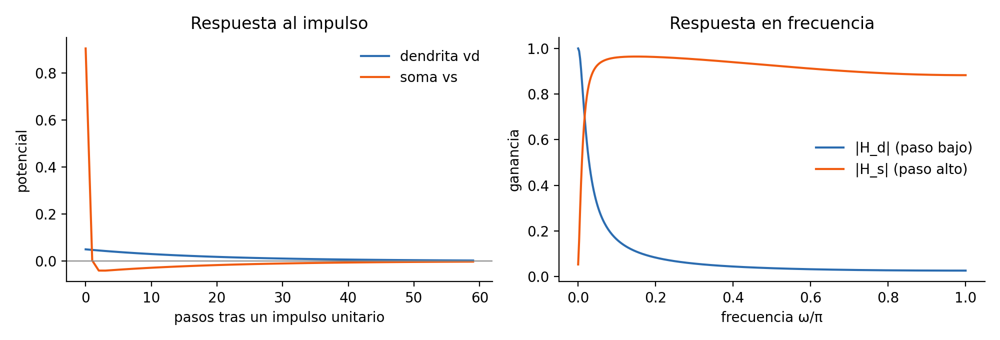

**Figura 1.** Respuesta al impulso (izquierda) y en frecuencia (derecha) de la neurona TS-LIF con $\alpha_1=0{,}95$, $\alpha_2=0{,}05$, $\beta_1=0$, $\beta_2=-0{,}9$, sin espigas. Fuente: elaboración propia a partir de las ecuaciones de Feng et al. (2025).

**Plasticidad.** En redes recurrentes de neuronas espigantes, la regla STDP (plasticidad dependiente del instante de disparo) refuerza una sinapsis si la neurona presináptica dispara justo antes que la postsináptica y la debilita en caso contrario; la regla iSTDP de Vogels et al. (2011) ajusta las sinapsis inhibitorias para mantener una tasa de disparo objetivo y equilibrar excitación e inhibición. Ambas son no supervisadas y causales.

### 3.3. Computación de reservorio

Un reservorio transforma la serie de entrada $u_t$ en un estado $\mathbf{x}_t = F(\mathbf{x}_{t-1}, u_t)$ de alta dimensión con parámetros fijos (o adaptados sin supervisión) y entrena solo una lectura $\hat y_t = g(\mathbf{x}_t)$. Las dos familias clásicas son las redes de estado de eco (ESN), con neuronas de activación continua (Jaeger, 2001), y las máquinas de estado líquido (LSM), con neuronas espigantes (Maass et al., 2002). Un buen reservorio debe cumplir dos propiedades: **separación** (entradas distintas producen estados distintos) y **memoria desvanecida** (el estado depende sobre todo del pasado reciente). Sus ventajas son el coste de entrenamiento mínimo y la ausencia de retropropagación a través del tiempo. Su riesgo es que la proyección aleatoria mezcle la información útil con ruido, de modo que una lectura simple no la recupere.

### 3.4. Árboles de decisión, bosques aleatorios y gradient boosting

Un **árbol de decisión** (CART) divide recursivamente el espacio de entrada con cortes paralelos a los ejes, eligiendo en cada nodo la variable y el umbral que más reducen la impureza (índice de Gini o entropía). Es interpretable y no lineal, pero de alta varianza.

Un **bosque aleatorio** (Breiman, 2001) promedia $B$ árboles entrenados sobre muestras bootstrap y, en cada división, considera solo un subconjunto aleatorio de $m_{try}$ variables. Si los árboles tienen varianza $\sigma^2$ y correlación media $\rho$, la varianza del promedio es $\rho\sigma^2 + (1-\rho)\sigma^2/B$: el submuestreo de variables reduce $\rho$ y, con ello, la varianza. Cada árbol deja fuera de su muestra bootstrap aproximadamente el 36,8 % de las observaciones, lo que permite estimar el error **fuera de bolsa** (OOB) sin un conjunto de validación; con datos dependientes en el tiempo ese estimador puede ser optimista, por lo que en este trabajo se comprueba en lugar de asumirse. Usado como lectura de un reservorio, el bosque equivale a un **ensamble de lectores sobre subconjuntos de neuronas**. Su limitación estructural es que una frontera oblicua (por ejemplo, «rápido − lento > umbral») solo se aproxima con muchos escalones.

El **gradient boosting** (Friedman, 2001) construye árboles de forma secuencial, cada uno ajustado a los residuos del anterior; la variante por histogramas utilizada en este trabajo discretiza las variables para acelerar el entrenamiento. La **regresión logística** modela $\log\frac{p}{1-p}$ como función lineal de las entradas; su parámetro de regularización $C$ controla la rigidez (cuanto menor $C$, más se encogen los coeficientes).

### 3.5. Métricas de evaluación

La métrica primaria es el **área bajo la curva ROC (AUC)** de la probabilidad de subida frente a la etiqueta real. Equivale a la probabilidad de que una barra de subida elegida al azar reciba una probabilidad mayor que una barra de bajada elegida al azar (estadístico de Mann–Whitney normalizado). El AUC no depende de un umbral de decisión ni se infla con el desbalance de clases; un AUC de 0,5 corresponde al azar y un AUC de 0,54 equivale aproximadamente a acertar la dirección entre un 52 % y un 53 % de las veces.

Como métricas secundarias se informan el **acierto** (proporción de direcciones correctas con umbral 0,5) y el **acierto selectivo**, definido como el acierto en el 20 % de barras con mayor $|\hat p - 0{,}5|$ menos el acierto global; mide si el modelo sabe cuándo es más fiable. Todas las métricas se calculan con un único módulo basado en scikit-learn y SciPy para evitar implementaciones divergentes.

### 3.6. Inferencia estadística con dependencia temporal

Las observaciones consecutivas de una serie financiera no son independientes; las pruebas que asumen independencia subestiman la incertidumbre. Se emplean cuatro herramientas:

- **Bootstrap de bloques emparejado** (Künsch, 1989): se remuestrean bloques contiguos de 60 barras (2 h) o 20 días (diario), los mismos para los dos modelos comparados, y se recalcula la diferencia de AUC; el intervalo de confianza del 95 % (IC95) son los percentiles 2,5 y 97,5 (Algoritmo 3).
- **Potencia:** bajo la hipótesis nula, el error estándar del AUC es $SE\approx\sqrt{(n+1)/(12\,n_1 n_0)}$, con $n_1$ y $n_0$ el número de subidas y bajadas; el AUC mínimo detectable con potencia del 80 % es $0{,}5+2{,}8\,SE$. Ante un resultado nulo se afirma «sin potencia para detectar AUC inferiores a X», nunca «no hay señal».
- **Placebo:** se barajan por bloques las etiquetas (o las entradas nuevas) y se repite el análisis; el AUC debe quedar en 0,50. Con unas 2 000 observaciones un único barajado oscila ±0,026, por lo que se usa la media de 10 barajados.
- **Equivalencia:** demostrar que dos modelos son equivalentes exige que el intervalo de su diferencia quede dentro de un margen fijado de antemano, por ejemplo ±0,010 de AUC (procedimiento TOST; Lakens, 2017). Un intervalo que contiene el cero solo indica ausencia de diferencia detectable.

---

## 4. Objetivos

### 4.1. Objetivo general

El objetivo general del trabajo es determinar, con un protocolo preregistrado y reproducible, si una red de reservorio con neuronas TS-LIF (E20-ALB) aporta información predictiva sobre la dirección de Bitcoin más allá de referentes simples y de modelos de aprendizaje automático que reciben la misma información.

### 4.2. Objetivos específicos

1. **Validar el protocolo** con series sintéticas de señal conocida: el placebo y la señal nula no deben producir señal, y la señal presente debe detectarse.
2. **Identificar qué componentes de la red original** (MDHS-SNN) aportan o restan, mediante ablación, hasta llegar a E20 y a E20-ALB.
3. **Comparar E20-ALB** con regresión logística, bosque aleatorio, gradient boosting, perceptrón multicapa, LSTM y la variante con atención TIA-LIF, en datos sintéticos y en BTC real.
4. **Determinar en qué escalas temporales** la dirección de BTC es predecible.
5. **Comprobar la réplica** en otros activos (BTC a 1 h, ETH a 2 h, PAXG a 2 h y mercados tradicionales diarios) y si nuevas fuentes de información elevan el techo de predictibilidad.
6. **Medir el coste computacional** de las versiones de E20 y explicar matemáticamente los resultados.

Para orientar la evaluación se fijaron cuatro hipótesis antes de los experimentos con BTC: **H1** (señal) E20-ALB obtiene en BTC a 2 h un AUC mayor que 0,5 de forma detectable; **H2** (superioridad preregistrada) AUC(E20-ALB) − AUC(bosque aleatorio con 10 entradas estándar) ≥ +0,010 con IC95 > 0; **H3** (misma información) si el reservorio solo recombina la información del precio, E20-ALB empatará (|Δ| < 0,010) con gradient boosting y regresión logística; **H4** (atención) la atención de TIA-LIF no aporta una ventaja demostrable sobre E20-ALB.

---

## 5. Metodología y desarrollo

En este capítulo se exponen los datos, el diseño experimental, la red propuesta y su origen, la variante con atención, los modelos de referencia, el análisis estadístico y los aspectos de implementación.

### 5.1. Datos utilizados

**Tabla 2.** Conjuntos de datos utilizados.

| Conjunto | Fuente | Periodo de desarrollo | Barras | Prueba (30 % final) |
|---|---|---|---|---|
| BTC/USDT 2 h | API pública de Binance; velas de 1 h agregadas y alineadas a la hora par UTC; PostgreSQL local | 2018-03-09 → 2026-09-25 | 37 420 | 11 225 (2024-03 → 2026-09) |
| BTC/USDT 1 h | Binance | últimas 40 000 barras (2022-03 → 2026-09) | 40 000 | 11 999 |
| ETH/USDT 2 h | Binance | 2018-05-29 → 2026-09-25 | 36 447 | 10 933 |
| PAXG/USDT 2 h (oro tokenizado) | Binance | 2020-09-25 → 2026-09-25 | 26 280 | 7 884 |
| BTC/USD diario | archivo fijo versionado | 2016-04-24 → 2026-04-25 | ≈ 3 650 | 1 095 días |
| BTC, 13 escalas (1 min a 1 mes) | Binance y serie diaria | hasta 2026-04-26 | 97 – 60 000 | 40 % final |
| NASDAQ, bono a 10 años, Brent, EURUSD, dólar amplio (diario) | FRED, CSV público | desde 1962–2006 hasta 2026-03 | 5 198 – 16 173 | 1 521 – 4 812 |
| Sintéticos | generadores propios con semillas fijas | — | ≈ 3 650 por serie | ≈ 1 090 |

**Calidad y trazabilidad.** Cada serie tiene un manifiesto con su suma sha256. Se detectaron 25 huecos horarios en BTC por mantenimiento de Binance, que se conservan como tales. El descargador se corrigió para no almacenar la vela todavía abierta, cuyo cierre aún no es definitivo. La serie diaria de BTC se mantiene en un archivo fijo versionado porque la fuente original dejó de estar disponible. **Datos sellados:** las barras de BTC y ETH posteriores al 2026-09-25 (97 barras de 2 h de BTC) y los datos diarios posteriores al 2026-04-01 no se han evaluado y se reservan para la confirmación final.

**Activos de réplica.** ETH es la segunda criptomoneda por capitalización y comparte mercado con BTC; PAXG es un token respaldado por oro físico que cotiza 24 horas en Binance y permite estudiar el oro a escala intradía (la serie del oro de futuros no pudo descargarse por limitaciones de la fuente de datos). Sus conclusiones valen para «PAXG a 2 h», no para el oro en general.

**Datos sintéticos.** Para disponer de una verdad conocida se generaron series tipo BTC con señal de intensidad $q$: en una proporción $q$ de los pasos la etiqueta sigue una regla y en el resto es aleatoria, de modo que el techo de acierto es $q+(1-q)/2$ (Tabla 3).

**Tabla 3.** Bancos sintéticos.

| Familia | Regla | Para qué sirve |
|---|---|---|
| REG | la dirección depende de si el movimiento reciente es grande respecto a la volatilidad de 20 pasos | señal no lineal multiescala |
| MOM3 | la dirección depende de la suma de los 3 retornos previos | señal lineal |
| CAOS | dinámica caótica (mapa logístico) con colas pesadas t(3) y volatilidad variable | serie tipo BTC difícil |
| VOLSHIFT | REG o MOM3 con la volatilidad del test a 0,3× o 3× la del entrenamiento | robustez a cambios de régimen |
| Placebo | $q=0$ | control negativo |

Cada banco tiene 8 realizaciones con semillas fijas; los bancos de confirmación (prefijos F2 y F3) usan semillas que no se vieron durante el desarrollo.

### 5.2. Diseño experimental

El estudio es experimental y comparativo y se rige por cuatro principios:

1. **Preregistro.** Cada experimento (datos, modelos, hipótesis numéricas y regla de decisión) se describe y se versiona con un commit y una etiqueta de git **antes** de ejecutarse; el resultado, favorable o no, se añade después como adenda (Apéndice A).
2. **Sintético primero, real después.** Las ideas se prueban de forma rápida con series sintéticas; la prueba definitiva es BTC a 2 h, con BTC a 1 h como apoyo.
3. **Misma información para todos.** Cada comparación incluye rivales de aprendizaje automático con exactamente las mismas entradas que el modelo espigante.
4. **Sellado.** Los datos posteriores a la fecha de corte quedan reservados para la confirmación final.

**Variable objetivo.** $y_t = 1$ si el retorno logarítmico de la barra siguiente $r_{t+1} > 0$ y 0 en otro caso. **Causalidad.** Toda variable de entrada en $t$ usa solo información hasta el cierre de la barra $t$; se comprueba con una prueba de truncamiento: recalcular la variable con la serie cortada en $t$ no debe cambiar su valor en $t$. **Partición.** Cronológica 70 % / 30 %; escalados, lecturas y modelos rivales se ajustan solo con el 70 % inicial. El reservorio no tiene pesos entrenados con etiquetas: su estado en $t$ depende únicamente del pasado.

**Entradas.** Para que la comparación sea justa se definen tres conjuntos de entradas (Tabla 4).

**Tabla 4.** Entradas de los modelos.

| Entrada | Contenido |
|---|---|
| **U** (10 entradas estándar) | 5 retardos de $r$ y 5 de $\lvert r\rvert$, escalados con el entrenamiento |
| **C** (canales multiescala) | medias móviles exponenciales de $\lvert r\rvert$ a 5, 22 y 60 periodos, retorno normalizado por la volatilidad reciente y momento de 3 periodos |
| **IND** (62 indicadores técnicos causales) | momentum (19), tendencia (17), volatilidad (11), volumen (9) y forma de las velas (6), calculados con pandas-ta 0.3.14b0 (acumulación/distribución y CMF implementados a mano) |

### 5.3. Red propuesta: E20-ALB

#### 5.3.1. Origen: la red MDHS-SNN

MDHS-SNN (*Multi-scale Dual-compartment Heterogeneous Sparse SNN*) es el reservorio original desarrollado por el autor: 1 000 neuronas TS-LIF, 800 excitatorias y 200 inhibitorias, con parámetros heterogéneos por neurona, conexiones recurrentes con plasticidad STDP excitatoria e iSTDP inhibitoria, ramas dendríticas adicionales inspiradas en DH-LIF y lecturas entrenadas. Los valores efectivos de la neurona en la configuración E20 se **verificaron capturando de forma no invasiva el núcleo de cálculo del simulador** (idénticos en series de 2 h y de 5 min): $\alpha_1 = 0{,}82$ (común a todas las neuronas), $\alpha_2 \in [0{,}05;\,0{,}25]$ (media 0,15), $\beta_1 \in [0;\,0{,}10]$ (media 0,05), $\beta_2 \in [-1{,}30;\,-0{,}71]$ (media −1,00), $\gamma_1, \gamma_2 \in [0{,}8;\,1{,}2]$, $\kappa \in [0{,}18;\,0{,}86]$ (media 0,50) y umbral $v_{th} \in [0{,}2;\,3{,}0]$. Difieren de los valores de ejemplo del artículo ($\alpha_1=0{,}95$, $\alpha_2=0{,}05$, $\beta_1=0$, $\beta_2=-0{,}9$): la dendrita de E20 es más rápida ($\tau = -1/\ln 0{,}82 \approx 5$ pasos), pero conserva $\beta_2<0$, es decir, el soma sigue restando la componente lenta. Todas las neuronas son estables ($\max|\lambda| = 0{,}82$ con la matriz de la ec. 10).

**Respuesta en frecuencia y detalles de implementación verificados.** Linealizando las ecuaciones del núcleo (sin umbral, reset ni rectificación) con los parámetros capturados, la ganancia mediana de la **dendrita** frente a una entrada periódica es 0,97 para el nivel constante, 0,70 para un periodo de 24 pasos, 0,22 para 6 pasos y 0,08 para 2 pasos; la del **soma** es 0,14 para el nivel, 0,65 para 24 pasos, 0,80–0,81 para 6–12 pasos y 0,67 para 2 pasos. En el 100 % de las neuronas la dendrita es un filtro **paso bajo** y el soma un filtro **paso banda**: como $\beta_2 \approx -1$, el soma responde a la diferencia entre la entrada actual y su media lenta, tal como propone el artículo (dendrita para la baja frecuencia, soma para la alta). La constante de tiempo dendrítica es común a todas las neuronas (unos 5 pasos); la diversidad de respuestas procede solo de $\alpha_2$, $\beta$, los retardos y los umbrales, y es moderada (por ejemplo, la ganancia dendrítica para un periodo de 24 pasos varía entre 0,61 y 0,79). El cálculo se reprodujo de forma independiente en una segunda revisión asistida (Apéndice E). Además, la lectura y la recurrencia usan la espiga «dendrita o soma» y no la mezcla $s_{mix}=\kappa s_d+(1-\kappa)s_s$ de la ec. 6, por lo que $\kappa$ **no influye** en E20; y el desplazamiento temporal TS-SNN con un solo paso ($T=1$) se reduce a la identidad ($0{,}4x+0{,}6x=x$), de modo que de ese bloque solo actúa la rectificación de las corrientes $\le 0{,}1$.

#### 5.3.2. Ablación: de MDHS-SNN a E20

Con un control positivo sintético (momentum, $q=0{,}7$; oráculo 69,8 %), MDHS-SNN obtenía solo un 56,4–57,8 % de acierto, mientras que modelos simples con la misma señal llegaban al 63–67 %. Se retiraron y modificaron componentes uno a uno (3 a 6 semillas, diferencias pareadas) hasta identificar las causas; el resultado es **E20**, que difiere de MDHS-SNN en cinco puntos:

1. **Entrada con signo por neurona:** cada neurona recibe $w_i\,c_t$ con $w_i\sim\mathcal N(0,1)$ fijo; antes todas recibían el mismo escalar, lo que hacía redundantes las 1 000 neuronas.
2. **Sin la cuarta rama dendrítica** (DH-LIF D4).
3. **Segundo canal de amplitud:** $\lvert r_t\rvert$ acotado, para conservar la información de volatilidad.
4. **Retardos de entrada** $d_i\sim U\{0,\dots,4\}$ pasos por neurona, que dan al reservorio memoria explícita de los últimos pasos.
5. **Escala fija** $2\tanh(c/2)$ en lugar de una normalización móvil que dividía la entrada por la volatilidad reciente y destruía parte de la señal.

La **E20 oficial (A0)** mantiene la recurrencia, recorre la serie una vez y se lee con una regresión logística muy regularizada ($C=3\cdot10^{-5}$).

#### 5.3.3. Supresión de la recurrencia: E20-A1

En E20-A1 la ganancia de las conexiones recurrentes es cero. Sin recurrencia, la plasticidad sináptica no interviene y el reservorio se reduce a una **proyección aleatoria fija** de la entrada a través de 1 000 neuronas TS-LIF con retardos. Esta simplificación se motivó por dos observaciones: la tasa de disparo de E20 era muy baja (la recurrencia estaba casi inactiva) y, en datos sintéticos, apagar la recurrencia mejoraba el AUC con cualquier lectura (sección 6.2). El Algoritmo 1 describe la simulación.

**Algoritmo 1.** Simulación del reservorio E20-A1.

```text
Entrada: serie de retornos r_1..r_T; parámetros por neurona (α1_i, α2_i, β1_i, β2_i, γ1_i, γ2_i, κ),
         pesos w_i ~ N(0,1) y u_i ~ N(0,1) fijos, retardos d_i ∈ {0..4}, umbral v_th
Salida: matriz de estados X ∈ R^{T×3001}
1  vd_i ← 0; vs_i ← 0; sd_i ← 0; ss_i ← 0 para i = 1..1000
2  para t = 1..T:
3      para cada neurona i:
4          c ← w_i · 2·tanh((r_{t−d_i}/escala)/2) + u_i · [2·tanh(|r_t/escala|/2) − 0,7]   # retardo solo en el canal con signo; amplitud del paso actual
5          vd_i ← α1_i·vd_i + β1_i·vs_i + (1−α1_i)·c − γ1_i·sd_i              # dendrita (ec. 5)
6          vs_i ← α2_i·vs_i + β2_i·vd_i + (1−α2_i)·c − γ2_i·ss_i              # soma, usa vd_i del mismo paso
7          sd_i ← H(vd_i − v_th); ss_i ← H(vs_i − v_th)
8      X[t] ← [vd_1..vd_1000, vs_1..vs_1000, espigas_1..espigas_1000, entrada normalizada]
9  devolver X                                                                  # sin recurrencia: ninguna sinapsis entre neuronas
```

#### 5.3.4. Lectura de bosque aleatorio: E20-ALB

E20-ALB añade a E20-A1 una **lectura de bosque aleatorio** sobre los **3 001 estados** de cada paso: 1 000 potenciales dendríticos, 1 000 potenciales somáticos, 1 000 salidas espigantes y la entrada normalizada, sin reducción de dimensión. Los hiperparámetros se fijaron antes de ver resultados y no se ajustaron después: 300 árboles, $m_{try}=\sqrt{p}\approx 55$ variables por división y un mínimo de 20 observaciones por hoja (Algoritmo 2, Figura 2).

La elección del bosque se motivó por tres limitaciones medidas de la lectura anterior más elaborada (gradient boosting sobre 30 componentes principales): la reducción a 30 componentes descartaba información, la selección por validación con unos 380 días era ruidosa y, con colas pesadas, los métodos de boosting perdían rendimiento mientras que el bosque no. Además, un bosque con submuestreo de variables sobre los estados completos es un ensamble de lectores sobre subconjuntos del reservorio, una idea con precedentes en el ensamble de máquinas de estado líquido.

**Algoritmo 2.** Entrenamiento y predicción de E20-ALB.

```text
Entrada: estados X (Algoritmo 1), etiquetas y, índice de corte te (70 % de la serie)
Salida: probabilidades de subida p para t ≥ te
1  E ← {t : t < te};  P ← {t : t ≥ te}
2  Z ← estandarizar(X) con media y desviación calculadas solo en E; recortar a [−10, 10]
3  bosque ← BosqueAleatorio(árboles = 300, m_try = √3001, hoja_mínima = 20, semilla fija)
4  ajustar bosque con (Z[E], y[E])
5  p[P] ← bosque.probabilidad_de_subida(Z[P])
6  (opcional, diagnóstico) error fuera de bolsa del bosque frente al error en P
7  devolver p
```

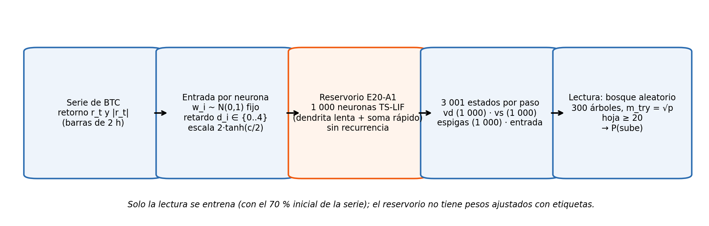

**Figura 2.** Arquitectura de E20-ALB. Fuente: elaboración propia.

Se evaluaron también dos variantes secundarias: **E20-ALA** (E20-A1 con lectura de gradient boosting sobre 30 componentes principales y selección adaptativa) y **E20-A0C** (E20 oficial con los 62 indicadores técnicos como canales de entrada, mediante pesos fijos $W\sim\mathcal N(0,1)/\sqrt{K}$, y lectura logística $C=10^{-3}$).

### 5.4. Variante con atención: TIA-LIF

TIA-LIF es una red de neuronas TS-LIF con atención temporal: las consultas y las claves se calculan con neuronas TS-LIF y el conjunto se entrena de extremo a extremo por retropropagación. Se utiliza la **versión corregida sin fuga** (sección 6.3.9): clasificación con etiqueta «retorno > 0», dimensión interna 32, ventana de 64 pasos, partición 70/30, 5 épocas preregistradas y un análisis de sensibilidad con 25 épocas. Recibe el cierre y el volumen de la vela (en los datos sintéticos, volumen constante). Para comparar con E20 se verifica que las filas de prueba coinciden exactamente comparando las etiquetas; el análisis se aborta si la coincidencia no es única.

### 5.5. Modelos de referencia

- **Regresión logística (LOGIT)**, con $C=1$ sobre entradas estandarizadas.
- **Bosque aleatorio (RF)**, con los mismos hiperparámetros que la lectura de E20-ALB (300 árboles, $m_{try}=\sqrt p$, hoja ≥ 20).
- **Gradient boosting por histogramas (GBM):** 200 iteraciones, tasa de aprendizaje 0,05, 15 hojas por árbol y 40 observaciones por hoja.
- **Perceptrón multicapa (MLP) y LSTM**, evaluados en los bancos sintéticos.
- **Mezcla de familias:** promedio de probabilidades de E20 oficial, E20-ALB y GBM(U+C), fijada antes del análisis final.
- **Referentes triviales:** clase mayoritaria y placebo.

### 5.6. Evaluación estadística

Las probabilidades se promedian entre las semillas de la red (701, 703, 704 y 705 en BTC a 2 h). Las comparaciones se hacen con diferencias pareadas de AUC y su IC95 por bootstrap de bloques emparejado (Algoritmo 3). El umbral de relevancia preregistrado es |ΔAUC| ≥ 0,010. En los bancos sintéticos un modelo «supera» a otro si la diferencia es ≥ 0,010, tiene el mismo signo en al menos 7 de las 8 realizaciones y su IC95 excluye el cero; en otro caso se declara «empate».

**Algoritmo 3.** Bootstrap de bloques emparejado para la diferencia de AUC.

```text
Entrada: etiquetas y_1..y_n, probabilidades p^A y p^B, longitud de bloque L (60), repeticiones R (p. ej. 2 000)
Salida: diferencia observada Δ y su IC95
1  Δ ← AUC(y, p^A) − AUC(y, p^B)
2  dividir los índices 1..n en bloques contiguos de longitud L
3  para k = 1..R:
4      elegir con reemplazo ⌈n/L⌉ bloques; I_k ← concatenación de sus índices
5      Δ_k ← AUC(y[I_k], p^A[I_k]) − AUC(y[I_k], p^B[I_k])          # mismos índices para A y B
6  IC95 ← [percentil 2,5 de Δ_k ; percentil 97,5 de Δ_k]
7  devolver Δ, IC95
```

### 5.7. Medición del coste computacional

Se añadió al simulador un contador de eventos, activable con una variable de entorno, que registra los disparos por paso, las operaciones sinápticas recurrentes efectivas y el coste de la lectura: 3 001 multiplicaciones-acumulaciones para la logística y las comparaciones efectivamente recorridas por el bosque (medidas con `decision_path`). El resultado son **operaciones, no julios**: el coste relativo de un disparo frente a una operación sináptica (κ) depende del hardware, por lo que se informa el punto de equilibrio.

### 5.8. Implementación y reproducibilidad

El trabajo se implementó en Python 3.9 con NumPy, pandas, scikit-learn, SciPy, Numba y PyTorch (este último solo para TIA-LIF), sobre Windows 11 con una CPU de 22 núcleos; la GPU integrada (Intel Arc con DirectML) resultó unas dos veces más lenta que la CPU para estos modelos. El simulador principal (`code/mdhs_snn_predictor.py`) usa variables de entorno opcionales que, cuando están apagadas, reproducen bit a bit la versión anterior; la reproducción exacta de E20 se verificó bit a bit en varias versiones del repositorio. Todas las métricas proceden de un único módulo (`metricas_oficiales.py`). Las rutas, scripts y etiquetas se detallan en los Apéndices A y B.

### 5.9. Consideraciones éticas y legales

No se utilizan datos personales. Los datos de mercado proceden de fuentes públicas y solo se publicará código y datos derivados permitidos por sus condiciones de uso. El trabajo no constituye una recomendación de inversión. El uso de herramientas de inteligencia artificial en el desarrollo del código, la ejecución de experimentos y la redacción se declara en el Apéndice E.

---

## 6. Resultados y discusión

Todos los resultados de este capítulo son **evidencia de desarrollo** salvo que se indique lo contrario; la prueba confirmatoria está definida en el Apéndice C. Las referencias entre corchetes (por ejemplo, [N65]) remiten a la adenda de la bitácora que contiene el resultado (Apéndice A).

### 6.1. Validación del protocolo

**Tabla 5.** Controles del protocolo.

| Control | Resultado | Esperado |
|---|---|---|
| Placebo sintético ($q=0$), E20-ALB | AUC 0,4993 ± 0,013 [N33] | 0,50 |
| Placebo en BTC 2 h (etiquetas barajadas por bloques) | 0,4984 [N65] | 0,50 |
| Caminata aleatoria diaria | E20 oficial 0,4991 [0,4734; 0,5246]; rivales 0,48–0,51 [N83c] | 0,50 |
| Momentum inyectado $q=0{,}7$ (control positivo) | E20 oficial 0,697 [0,670; 0,723]; E20-ALB 0,713; RF 0,709; GBM 0,705 [N83c] | ≥ 0,60 |
| Error fuera de bolsa del bosque frente al de prueba | −0,0092 a +0,0055 [N33] | \|diferencia\| < 0,02 |

El protocolo no produce señal donde no la hay y la recupera donde sí existe. El error fuera de bolsa del bosque no resultó optimista en estos datos (en los bancos REG fue incluso ligeramente pesimista), aunque no se utilizó para elegir modelos.

### 6.2. Experimentación con datos sintéticos

#### 6.2.1. Ablación de MDHS-SNN a E20

**Tabla 6.** Ablación de MDHS-SNN a E20 (control positivo de momentum, $q=0{,}7$; oráculo 69,8 %).

| Paso | Cambio | Acierto | Efecto medido |
|---|---|---|---|
| E0 | MDHS-SNN original | 57,8 % | — |
| E5 | entrada con signo por neurona | +3,0 ± 1,1 pp | la entrada escalar idéntica era un cuello de botella |
| E6 | + sin rama D4 | 62,7 % | +4,8 ± 0,4 pp (6 semillas) |
| E11 | + canal de amplitud | ≈ igual en dirección | AUC de movimiento +0,067 |
| E14 | + retardos 0–4 | 64,4 % | la memoria deja de limitar (R² de $r_{t-1..t-3}$ 0,83–0,87) |
| **E20** | + escala fija $2\tanh(c/2)$ | **66,0 %** (6 semillas) | **iguala a la TCN (66,5 %)** |

Desactivar STDP o iSTDP o aumentar la actividad recurrente no mejoró. Con la misma señal, otros modelos obtuvieron: LSM-LIF 63,6–64,3 %, regresión logística con 23 retardos 63,7 %, LSTM 65,4 % y TCN 66,5–67,0 %. La ablación convierte una red que perdía ocho puntos frente a modelos simples en una que iguala a la TCN. En BTC diario real (151 días posteriores, nunca observados), todos los modelos, incluida E20, quedaron en torno al 50 %: la red ganó capacidad, pero no encontró señal diaria.

#### 6.2.2. E20-ALB frente a modelos de aprendizaje automático

En la fase de desarrollo (11 bancos × 8 realizaciones) la lectura de bosque sobre los 3 001 estados de E20-A1 superó a la lectura de gradient boosting sobre 30 componentes principales en 3 de 5 bancos REG y en los 4 bancos caóticos, y a RF(U) en 3 de 5 bancos REG (por ejemplo, +0,0233 en T_REG_90, 8 de 8 realizaciones) [N33]. Para descartar que esa ventaja se debiera a haber mirado los bancos, se confirmó en bancos con semillas nunca vistas (Tabla 7, Figura 3).

**Tabla 7.** Confirmación en bancos sintéticos nunca vistos (AUC medio de 8 realizaciones) [N35].

| Banco | **E20-ALB** | RF(U) | RF con 20 retardos | GBM(U) | E20-ALA | E20 oficial |
|---|---|---|---|---|---|---|
| F2_REG_90 | **0,8511** | 0,8339 | 0,8155 | 0,8435 | 0,8489 | 0,7758 |
| F2_REG_70 | **0,7684** | 0,7541 | 0,7372 | 0,7437 | 0,7527 | 0,6909 |
| F2_REG_50 | **0,6781** | 0,6671 | 0,6541 | 0,6513 | 0,6523 | 0,6439 |
| F2_CAOS_60 | 0,6817 | 0,6805 | 0,6764 | 0,6680 | 0,6653 | 0,6721 |

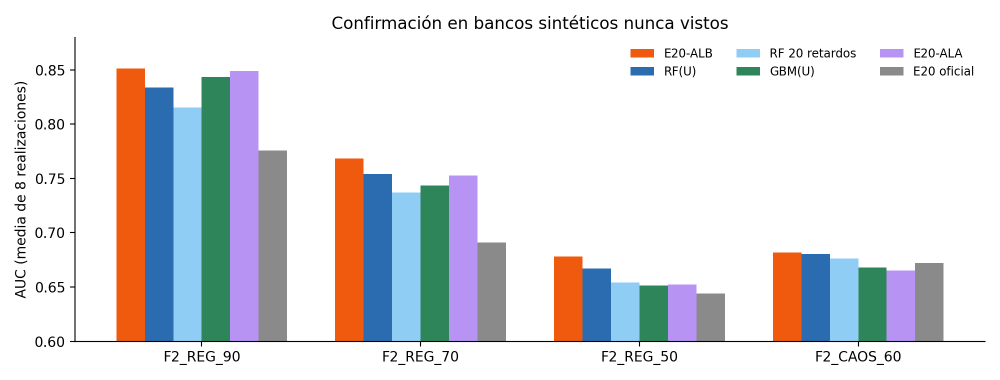

**Figura 3.** Confirmación de E20-ALB en bancos sintéticos nunca vistos. Fuente: elaboración propia [N35].

E20-ALB supera a RF(U) en F2_REG_70 (+0,0143; 8/8; IC [+0,0087; +0,0199]) y en F2_REG_50 (+0,0110; 7/8; IC [+0,0050; +0,0178]); en F2_REG_90 la diferencia (+0,0172) solo aparece en 6 de 8 realizaciones y se declara empate por el criterio estricto; en el banco caótico empatan (+0,0013). **En el balance total, E20-ALB supera a RF(U) en 5 de 9 bancos REG, empata en los otros 4 y en los 6 caóticos, y nunca queda por debajo.** En el ranking de los 8 bancos de referencia ocupa el primer puesto (Tabla 8).

**Tabla 8.** Ranking en 8 bancos sintéticos (AUC medio).

| Puesto | Modelo | AUC |
|---|---|---|
| 1 | **E20-ALB** | **0,741** |
| 2 | RF(U) | 0,731 |
| 3 | E20-ALA | 0,727 |
| 4 | GBM(U) | 0,725 |
| 5 | E20-A1 + MLP | 0,723 |
| 6 | MLP | 0,720 |
| 7 | LOGIT(U) | 0,709 |
| 8 | E20 oficial | 0,703 |
| 9 | LSTM | 0,643 |
| — | Clase mayoritaria | 0,506 |

#### 6.2.3. Ablaciones de E20-ALB

- **La recurrencia resta:** con la misma lectura de bosque, E20-A1 supera a E20 con recurrencia por +0,019 a +0,029 en los bancos REG (8 de 8 realizaciones) [N33, N35].
- **La reducción de dimensión descarta información:** el bosque sobre los 3 001 estados supera al bosque sobre 30 componentes principales por +0,005 a +0,014 [N33].
- **La ventaja no es memoria cruda:** un RF con 20 retardos queda por debajo de RF(U) con 5 y E20-ALB lo supera por +0,024 a +0,036 (8 de 8) [N34, N35].
- **La información está distribuida:** quedarse con las 60 neuronas más importantes empeora entre −0,001 y −0,028 y apenas mejora a 60 neuronas elegidas al azar; una proyección supervisada (PLS) empeora entre −0,024 y −0,082 [N39]. El bosque usa en la práctica unas 2 100 de las 3 001 variables.
- **Un número de variables elegido dinámicamente por validación** no mejora al uso de las 3 001 [N44].

#### 6.2.4. Límites de E20-ALB

1. **Frente a un rival con características multiescala.** Si el RF recibe los canales multiescala C, supera a E20-ALB con los mismos canales por unas 0,04 en REG (por ejemplo, 0,9154 frente a 0,8736, 0 de 8 realizaciones a favor de E20-ALB); un modelo híbrido con estados + U + C no mejora a RF(U+C) [N34]. El reservorio no añade información a un bosque que ya dispone de las características multiescala.
2. **Con una regla lineal (MOM3).** E20-ALB empata con RF en $q=0{,}7$ y $0{,}5$, queda por debajo en $q=0{,}9$ (−0,098, por un caso de fallo) y por debajo de la regresión logística en los tres bancos (−0,006 a −0,103) [N47]. La ventaja sobre RF es específica de las reglas de régimen.
3. **Con un cambio de régimen de volatilidad** (Figura 4). E20-ALB falla (acierto de prueba inferior al fuera de bolsa en más de 0,05) en **7 de 16 realizaciones (44 %)**; con un canal causal de volatilidad, en 3 de 16 (19 %). La causa medida es que los estados codifican amplitud: si la volatilidad de la prueba cae a un tercio, el 46 % de los estados queda en cero. RF(U+C) y GBM(U+C), con entradas normalizadas por la volatilidad, superan a E20-ALB con canal por 0,017 a 0,09 [N59].

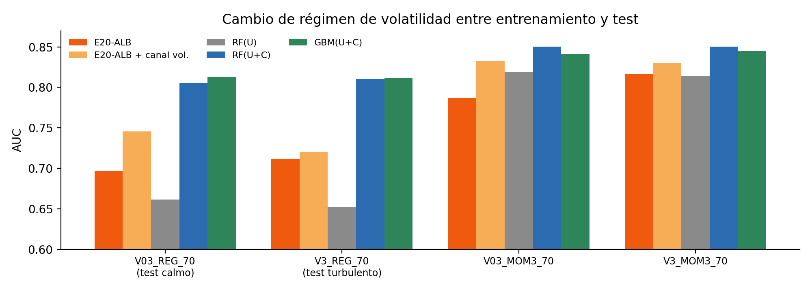

**Figura 4.** Rendimiento con cambio de régimen de volatilidad entre entrenamiento y prueba. Fuente: elaboración propia [N59].

#### 6.2.5. E20-ALB frente a TIA-LIF

**Tabla 9.** E20-ALB frente a TIA-LIF en datos sintéticos (5 épocas preregistradas; media de 3 realizaciones; mismas filas verificadas por etiquetas) [N80].

| Banco | TIA-LIF | **E20-ALB** | E20 oficial | LOGIT(U) | RF(U) | GBM(U+C) |
|---|---|---|---|---|---|---|
| F2_REG_90 | 0,803 | **0,917** | 0,859 | 0,859 | 0,896 | 0,940 |
| F2_REG_70 | 0,721 | **0,826** | 0,777 | 0,771 | 0,815 | 0,849 |
| F3_MOM3_70 | 0,831 | **0,842** | — | 0,843 | 0,836 | 0,843 |
| F2_CAOS_60 | 0,565 | **0,730** | 0,717 | 0,719 | 0,731 | 0,718 |

E20-ALB supera a TIA-LIF por al menos 0,010 en los 4 bancos (+0,114; +0,105; +0,012; +0,165). Como TIA-LIF no había convergido a las 5 épocas (su AUC seguía subiendo), se repitió con **25 épocas**, eligiendo además su mejor época mirando el test, una cota optimista a su favor [N80a]: TIA-LIF mejora entre 0,03 y 0,10 y converge entre las épocas 5 y 16, pero sigue por debajo de E20-ALB en 3 de 4 bancos (−0,037, −0,059 y −0,044) y empata en MOM3 (+0,009). Con 25 épocas solo supera a la regresión logística de retardos en un banco (+0,014) (Figura 5).

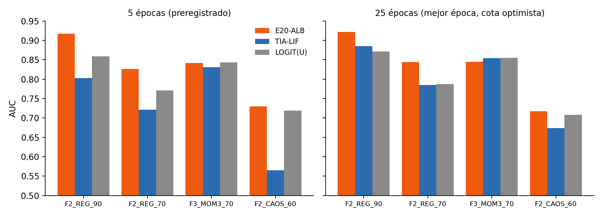

**Figura 5.** E20-ALB frente a TIA-LIF con 5 y 25 épocas de entrenamiento. Fuente: elaboración propia [N80, N80a].

### 6.3. Experimentación con Bitcoin y otros activos

#### 6.3.1. ¿En qué escala temporal es predecible la dirección?

Se realizó un estudio homogéneo en 13 escalas, desde 1 minuto hasta 1 mes, con el mismo protocolo: partición 60 % / 40 %, validación progresiva con regresión logística y GBM sobre retardos, 9 nulos barajados y 9 nulos IAAFT (que conservan el espectro y la distribución de la serie), intervalos por bloques y corrección de Holm (Tabla 10, Figura 6).

**Tabla 10.** Predictibilidad de la dirección de BTC por escala temporal.

| Escala | AUC (mejor de logística y GBM) | AUC mínimo detectable | Veredicto |
|---|---|---|---|
| 1 min | 0,532 | 0,510 | señal |
| 5 min | 0,518 | 0,510 | no supera el nulo IAAFT |
| 15 min | 0,536 | 0,510 | señal |
| 30 min | 0,524 | 0,510 | señal |
| 1 h | 0,543 | 0,510 | señal |
| **2 h** | **0,547** | 0,514 | **señal máxima** |
| 4 h | 0,540 | 0,519 | no supera el nulo IAAFT (0,555) |
| 12 h | 0,519 | 0,533 | sin señal |
| 1 día | 0,525 | 0,547 | sin señal |
| 3 días | 0,490 | 0,581 | sin señal |
| 1 semana, 2 semanas, 1 mes | 0,544–0,554 | 0,625–0,766 | no decidible (sin potencia) |

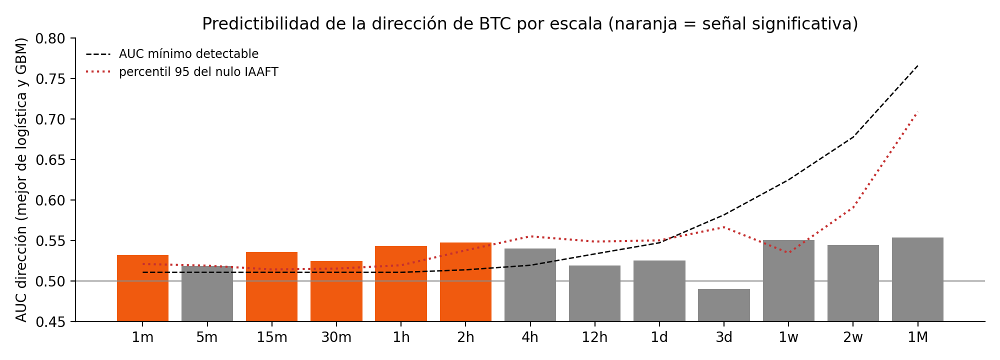

**Figura 6.** AUC de dirección por escala temporal, con el AUC mínimo detectable y el percentil 95 del nulo IAAFT. Fuente: elaboración propia.

**Solo se detectó señal de dirección entre 1 minuto y 2 horas** con los modelos y tamaños de muestra evaluados (fuera de ese intervalo no se detectó señal, lo que no equivale a demostrar su ausencia), con el máximo a 2 h; por eso se eligió 2 h como escala principal. En escalas semanales o mensuales el número de observaciones es tan pequeño que solo se detectarían AUC superiores a 0,62–0,77. Como evidencia adicional, en una evaluación previa del proyecto con bloque final reservado a 15 minutos (2026-05-26 → 2026-09-25, 11 788 velas, protocolo congelado), E20 obtuvo un AUC de 0,526: señal real, pero menor que en desarrollo (0,540) y empatada con GBM. Esa caída se explicó por un cambio del mercado (la autocorrelación de primer orden pasó de −0,024 a −0,002), por el decaimiento temporal de la señal y por el sesgo optimista del desarrollo.

#### 6.3.2. Resultado principal: BTC a 2 horas

**Tabla 11.** AUC en BTC a 2 h (prueba de 11 225 barras, 2024-03 → 2026-09; 4 semillas) [N65].

| Modelo | AUC |
|---|---|
| Mezcla de familias | 0,5381 |
| E20-ALB + canal de volatilidad | 0,5376 |
| E20 oficial (A0 + logística) | 0,5374 |
| E20-A1 + logística | 0,5374 |
| GBM(U+C) | 0,5374 |
| LOGIT(U) | 0,5364 |
| GBM(U) | 0,5360 |
| **E20-ALB** | **0,5359** |
| RF(U+C) | 0,5306 |
| RF(U) | 0,5294 |
| Placebo | 0,4984 |

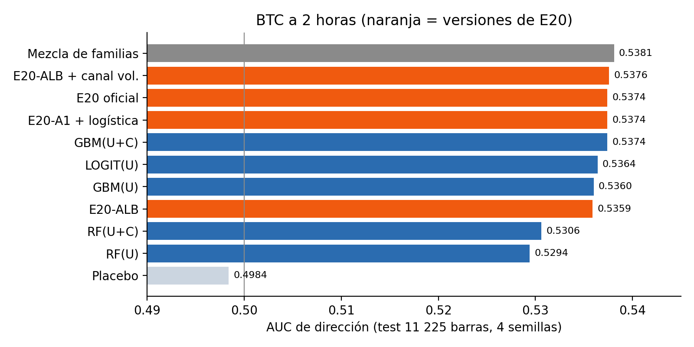

**Figura 7.** AUC de dirección en BTC a 2 h por modelo. Fuente: elaboración propia [N65].

**Tabla 12.** Diferencias pareadas de E20-ALB con cada rival en BTC a 2 h (IC95 por bootstrap de bloques de 60 barras emparejado) [N65].

| Comparación | ΔAUC [IC95] | Lectura |
|---|---|---|
| E20-ALB − RF(U) | **+0,0065 [+0,0013; +0,0121]** | mejor que RF, por debajo del umbral +0,010 |
| E20-ALB − RF(U+C) | +0,0052 [+0,0002; +0,0099] | igual |
| E20-ALB − GBM(U+C) | −0,0015 [−0,0063; +0,0031] | empate |
| E20-ALB − LOGIT(U) | −0,0005 [−0,0067; +0,0053] | empate |
| E20-ALB − E20 oficial | −0,0015 [−0,0071; +0,0037] | empate |
| Bosque sobre A1 − bosque sobre A0 | +0,0032 [−0,0006; +0,0069] | empate |
| Mezcla − mejor componente | +0,0007 | la diversidad no ayuda |

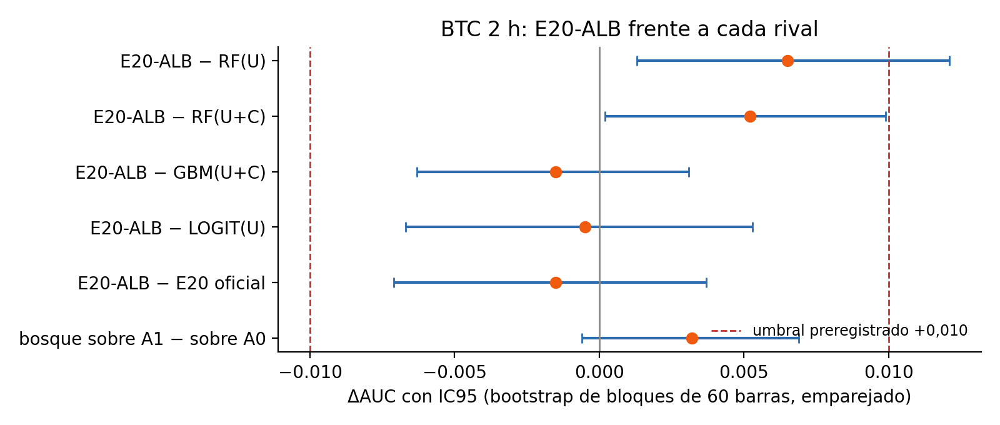

**Figura 8.** Diferencias pareadas de E20-ALB con cada rival en BTC a 2 h. Las líneas discontinuas marcan el umbral preregistrado de ±0,010. Fuente: elaboración propia [N65].

Con 11 225 barras el error estándar del AUC bajo el nulo es ≈ 0,0055 y el AUC mínimo detectable ≈ 0,515; todas las versiones de E20 (0,533–0,538) quedan muy por encima y el placebo da 0,498. El acierto global máximo es de aproximadamente un 52,4–53 % para todos los modelos razonables. Apagar la recurrencia o usar el bosque no mejora el AUC en BTC a 2 h, y el canal de volatilidad añade +0,0017 [−0,0020; +0,0060]. RF es el modelo más débil (unas −0,006 frente al resto).

**Señal por hora del día.** Las barras de las 20 h UTC (AUC ≈ 0,62–0,63) y de las 00 h UTC (0,57–0,60) concentran la señal en **todos** los modelos, mientras que las de 08–14 h UTC quedan en 0,49–0,52. Es una propiedad de los datos, no de E20. Desfasar las barras una hora no cambia el AUC de ningún modelo (|Δ| ≤ 0,007; los IC incluyen el cero) [N63].

#### 6.3.3. Confirmación en periodos anteriores de BTC: ¿cuál es la mejor versión de E20?

El resultado de la sección anterior procede de un único periodo de prueba (2024-03 → 2026-09), el mismo en el que se eligió la lectura de la variante con indicadores E20-A0C ($C=10^{-3}$, entre tres valores). Para decidir con datos de BTC cuál es la mejor versión de E20 sin ese sesgo, se preregistró una prueba en dos periodos **anteriores** de BTC a 2 h que no se usaron para elegir ninguna lectura ni los indicadores [N87]: B1 (2021-08-11 → 2022-11-22, 5 613 barras) y B2 (2022-11-22 → 2024-03-04, 5 614 barras). En cada bloque, las lecturas y los rivales se reajustan solo con los datos anteriores al bloque (ventana creciente), sin volver a simular la red. Se fijó de antemano que una versión solo se declararía «la mejor» si superase a cada una de las demás por al menos 0,005 de AUC con un IC95 positivo.

**Tabla 13.** AUC en periodos anteriores de BTC a 2 h (B1 + B2: 11 227 barras; AUC mínimo detectable 0,515) [N87].

| Modelo | B1 | B2 | Media de B1 y B2 |
|---|---|---|---|
| GBM(U+C+IND) | 0,5707 | 0,5794 | **0,5751** |
| LOGIT(U+C+IND) | 0,5715 | 0,5740 | 0,5727 |
| GBM(U+C) | 0,5642 | 0,5793 | 0,5718 |
| **E20-ALB** | 0,5675 | 0,5732 | **0,5704** |
| E20-A1 + logística | 0,5650 | 0,5751 | 0,5701 |
| **E20-A0C** ($C=10^{-3}$) | 0,5587 | 0,5783 | 0,5685 |
| RF(U) | 0,5618 | 0,5712 | 0,5665 |
| E20 oficial | 0,5629 | 0,5695 | 0,5662 |
| LOGIT(U) | 0,5627 | 0,5680 | 0,5653 |

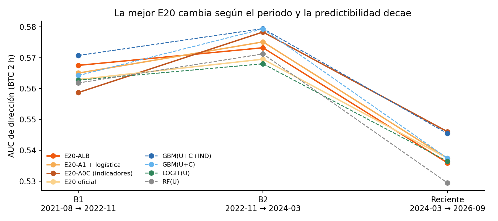

**Figura 9.** AUC de dirección de BTC a 2 h en tres periodos consecutivos: las versiones de E20 (líneas continuas) y los modelos de aprendizaje automático (discontinuas). Fuente: elaboración propia [N65, N85, N87].

Los resultados preregistrados son cuatro. **(1)** La mejora de E20-A0C sobre la misma red sin indicadores **no se confirma**: +0,0033 [−0,0014; +0,0086] sobre las predicciones concatenadas de B1 y B2, con signo negativo en B1 (−0,0026) y positivo en B2 (+0,0068). **(2)** Frente al gradient boosting con las mismas entradas, E20-A0C queda **por debajo**: −0,0084 [−0,0143; −0,0017] sobre las predicciones concatenadas (la diferencia de las medias por bloque de la Tabla 13 es −0,0066); por la regla preregistrada (|Δ| < 0,010) se clasifica como empate, pero el intervalo excluye el cero. **(3)** Los indicadores reales son mejores que los mismos indicadores permutados (+0,0118 [+0,0053; +0,0187], sobre las predicciones concatenadas y con 2 semillas), aunque parte de ese contraste refleja el daño que hacen los canales de ruido. **(4)** La versión de E20 con mayor AUC es **E20-ALB**, pero no se declara «la mejor»: empata con E20-A1 + logística (+0,0006), con E20-A0C (+0,0036 [−0,0042; +0,0097]) y con E20 + logística $C=10^{-3}$ (+0,0069 [−0,0007; +0,0133]). Frente a la E20 oficial, la diferencia calculada sobre los dos bloques unidos es +0,0102 [+0,0026; +0,0168], pero bloque a bloque solo es +0,0046 y +0,0037, sin significación: al unir bloques se mezclan probabilidades de dos reajustes con escalas distintas, lo que penaliza a la lectura rígida de la E20 oficial. Por eso la Tabla 13 informa también la media de los AUC por bloque; los IC de los contrastes concatenados no corresponden a la diferencia de medias presentada en esa tabla.

En conjunto, **no existe una única «mejor E20» en BTC**: E20-ALB es la versión con mayor AUC en 2021–2024 y E20-A0C en 2024–2026, y las diferencias entre ambas están dentro del error. En los dos periodos anteriores, el aprendizaje automático con indicadores técnicos (GBM y logística con U+C+IND) queda ligeramente por encima de todas las versiones de E20. Además, la predictibilidad **decae con el tiempo** para todos los modelos: AUC de 0,56–0,58 en 2021–2024 frente a 0,53–0,55 en 2024–2026 (Figura 9).

#### 6.3.4. Réplica en otros activos y escalas

**Tabla 14.** Réplica en otros activos (AUC).

| Serie | E20-ALB | E20 oficial | GBM(U+C) | LOGIT(U) | RF(U) | E20-ALB − RF(U) [IC95] | Placebo |
|---|---|---|---|---|---|---|---|
| BTC 2 h (4 semillas) [N65] | 0,5359 | 0,5374 | 0,5374 | 0,5364 | 0,5294 | +0,0065 [+0,0013; +0,0121] | 0,498 |
| BTC 1 h (1 semilla) [N67] | 0,5355 | — (A1 + logística 0,5386) | 0,5307 | 0,5296 | 0,5295 | +0,0060 [−0,0024; +0,0135] | 0,503 |
| ETH 2 h (2 semillas) [N68] | **0,5402** | 0,5392 | 0,5363 | 0,5377 | 0,5286 | **+0,0115 [+0,0046; +0,0178]** | 0,482 |
| PAXG 2 h (4 semillas) [N84] | **0,5390** | 0,5317 | 0,5393 | 0,5374 | 0,5342 | — | 0,506 |

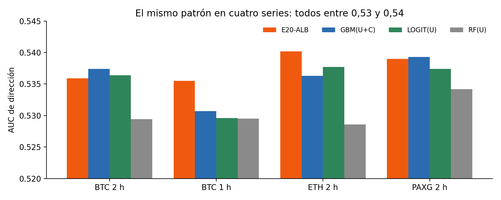

**Figura 10.** AUC en cuatro series: el mismo patrón en todas. Fuente: elaboración propia [N65, N67, N68, N84].

En ETH a 2 h, E20-ALB es la versión de E20 con mayor AUC y supera a RF(U) con el criterio estricto, la primera vez que ocurre en datos reales, pero empata con GBM(U+C) (+0,0039) y con la logística (+0,0025); el placebo (0,482) está en el límite de la tolerancia y se señala como cautela. En PAXG a 2 h, E20-ALB (0,5390) supera a la E20 oficial (+0,0073; IC [+0,0011; +0,0134]) e iguala a GBM (0,5393). El patrón se repite en las cuatro series: **todos los modelos razonables entre 0,53 y 0,54; E20-ALB empata con GBM y con la logística y supera ligeramente a RF.**

#### 6.3.5. ¿Elevan el techo otras fuentes de información?

**Tabla 15.** Información adicional sumada a las entradas en BTC a 2 h [N54, N71–N76].

| Información añadida | ΔAUC |
|---|---|
| Retornos de ETH en la misma hora | −0,0002 a +0,0019 |
| Tasa de financiación de los contratos perpetuos | −0,0009 a +0,0027 |
| Flujo de órdenes de las velas (desequilibrio comprador, número de operaciones, volumen) | +0,0004 a +0,0047 |
| Calendario (hora y día) | +0,0019 |
| Re-ajuste móvil de la lectura | +0,0011 |

Ninguna fuente nueva eleva el techo de forma relevante. La única con ganancia medible son los **62 indicadores técnicos**: un GBM sobre los indicadores solos alcanza 0,5516 frente a 0,5361 (entre +0,0110 y +0,0155 en 5 de 5 semillas; placebo 0,498) [N81, N82], pero la réplica solo reproduce el signo (ETH a 2 h +0,0097; BTC a 1 h +0,0053) y en PAXG la ganancia equivale a conocer la hora y el día [N84]. Introducidos como canales de entrada de E20 (E20-A0C) con lectura logística $C=10^{-3}$, dan la **E20 con mayor AUC medido: BTC 0,5460, PAXG 0,5502 y ETH 0,5464**, que **iguala** a GBM con las mismas entradas (+0,0007; +0,0033; +0,0012) [N85, N86]. La mejora frente a E20 sin indicadores se replica en PAXG (+0,0135; IC > 0) pero no en ETH (+0,0045; IC toca 0), y el valor $C=10^{-3}$ se eligió entre tres mirando el test de BTC: resultado exploratorio. En los periodos anteriores de BTC, con $C$ fijo, la mejora no se confirmó (sección 6.3.3).

#### 6.3.6. Entrada de alta frecuencia y modificaciones teóricas de la neurona

Si la información de las barras de 2 horas está agotada, la secuencia de velas de 5 minutos dentro de cada barra podría contener señal que los agregados pierden. Se evaluó E20-A1 recibiendo directamente los 24 retornos de 5 minutos de cada barra, con los parámetros capturados del simulador, frente a rivales que reciben **la misma serie causal de 5 minutos**: los rivales reciben explícitamente las últimas 72 velas (24 en el control), mientras el estado de E20 evoluciona continuamente. Los rivales son la regresión logística sobre la secuencia, ROCKET (1 000 núcleos convolucionales aleatorios) y *gradient boosting* sobre la secuencia, todos además con las entradas de 2 horas y los indicadores [N89]. La hipótesis principal exigía que E20 superara al **máximo** de los seis rivales de secuencia por +0,010 (con el máximo recalculado en cada réplica del bootstrap). El simulador rápido reproduce al original paso a paso (diferencias de potencial ≤ 6·10⁻¹¹ y espigas idénticas) y un **control positivo** sintético, cuya etiqueta depende del orden de las velas dentro de la barra (oráculo 0,802), confirmó que la tubería detecta esa señal: el mejor modelo de secuencia alcanzó 0,790–0,805 y el modelo con solo agregados de 2 horas, 0,505–0,516.

**Tabla 16.** Entrada de 5 minutos y modificaciones de la neurona: diferencias de AUC [IC95] [N89–N91].

| Contraste | Sintético (orden intrabarra) | BTC 2021–2024 (B1–B2) | BTC 2019–2021 (B0, cribado) |
|---|---|---|---|
| E20 (5 min) − mejor rival de secuencia | −0,0461 | −0,0028 [−0,0091; −0,0006] | −0,0025 [−0,0117; +0,0014] |
| E20 (5 min) − GBM con entradas de 2 h | +0,2485 | −0,0004 [−0,0062; +0,0058] | −0,0008 [−0,0107; +0,0089] |
| Logística con secuencia − logística sin secuencia | +0,2830 | −0,0050 [−0,0084; −0,0018] | +0,0002 [−0,0049; +0,0054] |
| Lectura temporal (estados a media barra y conteos separados sd/ss) − E20 | +0,0401 [+0,0351; +0,0454] | no evaluado* | +0,0007 [−0,0025; +0,0041] |
| Soma con ½·β₂ − E20 | −0,0024 | no evaluado | +0,0003 [−0,0013; +0,0018] |
| Sin reset dendrítico − E20 | −0,0044 | no evaluado | +0,0015 [−0,0012; +0,0040] |
| Dendrita lenta (α₁ = 0,992) − E20 | — | −0,0009 [−0,0034; +0,0016] | — |

\* El árbol de decisión condicionaba la evaluación de la lectura temporal en 2021–2024 a que la secuencia «mejorase» a GBM con entradas de 2 horas, sin fijar allí un umbral. Tras ver N89 se aplicó el criterio común documentado (media ≥ +0,010 e IC95 inferior > 0): el máximo de los seis rivales de secuencia dio +0,0024 [+0,0003; +0,0087]. Esta resolución posterior de la ambigüedad quedó registrada en la bitácora; la evaluación no se ejecutó.

**En datos sintéticos**, E20 detecta el orden de las velas (AUC 0,74–0,76) pero queda −0,046 por debajo del mejor rival: con $\alpha_1 = 0{,}82$, la dendrita conserva solo $0{,}82^{12} \approx 0{,}09$ de lo ocurrido doce velas antes, y la lectura ve únicamente el estado al cierre. Leer además, por separado, los **conteos de espigas dendríticas y somáticas en cada mitad de la barra** recupera entre el 84 % y el 90 % de esa brecha, mientras que dos filtros exponenciales leídos en los mismos instantes no lo consiguen (+0,0390 [+0,0338; +0,0451] a favor de la lectura con espigas) [N90]: los conteos actúan como integradores de ventana rectangular, que es justo la forma de la regla sintética.

**En BTC**, en cambio, E20 con entrada de 5 minutos quedó ligeramente **por debajo** del mejor rival de secuencia: −0,0028 [−0,0091; −0,0006] (AUC medio 0,5723 frente a 0,5751; placebo 0,500), y no alcanzó la mejora exigida frente a GBM con entradas de 2 horas (−0,0004 [−0,0062; +0,0058]). Ningún rival individual mostró una mejora con IC95 positivo frente a ese GBM; el máximo de los seis obtuvo +0,0024 [+0,0003; +0,0087], inferior al umbral práctico de +0,010, y la secuencia empeoró a la regresión logística (−0,0050). La dendrita lenta y los conteos de espigas de la barra tampoco aportan. Por ello no se cumplen las hipótesis de superioridad (HF1 y HF2). Tres cambios derivados de la teoría —que el soma reste solo la mitad de la dendrita (½·β₂, desvío declarado de la ec. 5 que multiplica por 2,6 la ganancia de nivel del soma con la misma estabilidad), suprimir el reset dendrítico (memoria dendrítica sin reset, como en DH-LIF) y la lectura temporal anterior— se cribaron en un bloque de BTC nunca usado para evaluar a esta escala (oct-2019 → ago-2021; placebo 0,502): ninguna se acerca al +0,010 exigido y todos los modelos quedan entre 0,561 y 0,566 [N91]. Para no buscar un ganador por azar en datos ya usados, se fijó por escrito, antes de conocer los resultados, que solo cabía un intento nuevo sobre los bloques de 2021–2024.

El diseño distingue dos explicaciones: **el mecanismo de lectura funciona** (sintético), pero **con estos modelos y bloques no se detectó en BTC una ganancia intrabarra de la magnitud preregistrada**; una señal menor, o explotable por otros modelos, sigue siendo posible. La entrada de alta frecuencia no cambia la conclusión de la sección 6.3.2.

#### 6.3.7. Mercados tradicionales a escala diaria

**Tabla 17.** E20 oficial en mercados tradicionales diarios (4 semillas; IC por bloques de 20 días; placebo = media de 10 barajados) [N83].

| Activo (desde) | n prueba | E20 oficial [IC95] | Mejor rival | AUC mínimo detectable |
|---|---|---|---|---|
| NASDAQ (1971) | 4 170 | 0,4907 [0,4730; 0,5071] | RF 0,4925 | ≈ 0,525 |
| Bono a 10 años (1962) | 4 812 | 0,4964 [0,4807; 0,5134] | RF 0,5017 | 0,523 |
| Brent (1987) | 2 690 | 0,5070 [0,4856; 0,5287] | RF 0,5253 | ≈ 0,531 |
| EURUSD (1999) | 2 048 | 0,4852 [0,4604; 0,5076] | GBM 0,4988 | ≈ 0,536 |
| Dólar amplio (2006) | 1 521 | 0,5031 [0,4754; 0,5268] | GBM 0,5206 | 0,541 |

A escala diaria no hay señal de dirección detectable con ningún modelo en estos cinco mercados; E20 empata con los rivales y los placebos son limpios. Coincide con BTC diario, donde todas las versiones de E20 quedan en el nivel de la clase mayoritaria (0,509–0,512 de acierto en 1 095 días). El oro de futuros, el S&P 500 y la plata no pudieron evaluarse por bloqueo de la fuente de datos.

#### 6.3.8. Predicción selectiva por confianza

**Tabla 18.** Acierto en el 20 % de barras de mayor confianza menos acierto global, BTC a 2 h [N65].

| Modelo | Diferencia [IC95] |
|---|---|
| E20 oficial (logística) | **+0,0420 [+0,0265; +0,0586]** (≈ 56,6 % frente a 52,4 %) |
| GBM(U+C) | +0,0327 [+0,0161; +0,0529] |
| E20-A1 + logística | +0,0299 [+0,0120; +0,0470] |
| LOGIT(U) | +0,0282 [+0,0117; +0,0472] |
| E20-ALB | +0,0140 [−0,0039; +0,0301] |
| Placebo | +0,0049 |

Las lecturas suaves (logística, GBM) ordenan mejor por confianza que las basadas en bosque: E20 oficial supera a E20-ALB en acierto selectivo por +0,0223 [+0,0043; +0,0432]. Es un resultado exploratorio y sin costes de transacción.

#### 6.3.9. Coste computacional

**Tabla 19.** Coste por predicción en BTC a 2 h (semilla 701; contador de eventos, no julios) [N69].

| Versión | Disparos por paso | Operaciones recurrentes efectivas por paso | Lectura | Coste total (κ = 1) | AUC |
|---|---|---|---|---|---|
| E20 oficial (A0) + logística | 11,5 | 11 441 | 3 001 MAC | 15 453 | 0,5374 |
| E20-A1 + logística | 152,7 | 0 | 3 001 MAC | **4 154** | 0,5374 |
| **E20-ALB** | 152,7 | 0 | 4 238 comparaciones | **5 390** | 0,5359 |

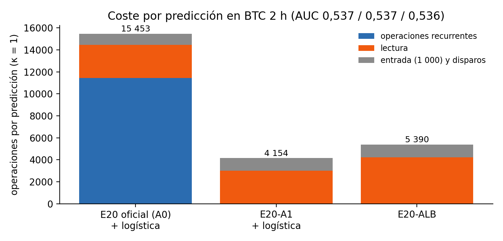

**Figura 11.** Coste por predicción de las tres versiones de E20 en BTC a 2 h. Fuente: elaboración propia [N69].

Apagar la recurrencia multiplica por 13,3 los disparos, porque desaparece la inhibición, pero elimina las operaciones recurrentes: E20-ALB cuesta unas 2,9 veces menos que la E20 oficial mientras un disparo valga menos de unas 81 operaciones sinápticas. El bosque recorre 4 238 comparaciones por predicción y usa 2 372 de las 3 001 variables. A igual AUC, la versión más eficiente es E20-A1 con lectura logística.

#### 6.3.10. Estudio de caso: fuga de información en TIA-LIF

Los resultados históricos de TIA-LIF (87–94 % de acierto diario) motivaron una auditoría línea a línea del código. Se encontró que un desplazamiento temporal tomado de un módulo pensado para los micro-pasos de simulación se había aplicado sobre el eje de **días**: la posición $t$ recibía la entrada de $t+1$, que contiene la etiqueta. Una prueba objetiva de causalidad (alterar el futuro y comprobar si cambia la salida en $t$) dio un cambio de 0,12 en la versión original y de 0,0 en la corregida. Se re-ejecutó la configuración récord (Tabla 19).

**Tabla 20.** Efecto de la fuga en TIA-LIF (dirección diaria).

| Versión | Acierto en posiciones con fuga | Acierto en la última posición (sin fuga) | Clase mayoritaria |
|---|---|---|---|
| Con desplazamiento $t+1$ | 0,894 | 0,594 | 0,593 |
| Corregida (15 épocas) | — | 0,544 | 0,602 |

El ~90 % era fuga; sin ella, TIA-LIF diario no supera a la clase mayoritaria. El caso ilustra la crítica de la literatura (sección 2.2) y justifica las salvaguardas del protocolo: prueba de causalidad, placebos y alineación por etiquetas.

#### 6.3.11. Resumen de la comparación con TIA-LIF en BTC

En BTC a 2 h (semillas 701 y 703; 11 208 barras comunes) TIA-LIF obtuvo 0,5392, la E20 oficial 0,5385, GBM(U+C) 0,5383, la logística 0,5366, E20-ALB 0,5354 y RF(U) 0,5296 [N80]. La diferencia entre E20-ALB y TIA-LIF fue +0,0011 en una semilla y −0,0087 en la otra: empate por el umbral preregistrado. La variabilidad de TIA-LIF entre semillas (0,5349 a 0,5435) es mayor que su diferencia con los demás modelos. Salvedad: TIA-LIF recibió el volumen real de la vela y los demás modelos solo retornos.

### 6.4. Discusión

**Por qué E20-ALB supera a un bosque con entradas estándar.** En la regla de régimen REG, la etiqueta depende de si el movimiento reciente es grande **respecto de la volatilidad lenta**. Ese es exactamente el cálculo que hace el bloque TS-LIF: el soma recibe la entrada actual y, mediante $\beta_2<0$, resta la dendrita lenta, de modo que su potencial es una combinación «rápido − lento». Sobre series nuevas, un único umbral oblicuo sobre (rápido − lento) reconoce la condición con un 95,0 % de acierto, mientras que un árbol sobre [rápido, lento] necesita profundidad 5 para llegar al 93,4 % y, sobre 5 retardos crudos de $\lvert r\rvert$, solo alcanza el 88,5 % con profundidad 8 (Figura 12) [N41]. Es decir, **la neurona TS-LIF calcula de forma nativa una característica oblicua que un árbol solo aproxima con escalones**. Cuando el bosque recibe los 3 001 estados, dispone de muchas versiones ruidosas de esa característica y supera a un RF que solo ve retardos crudos.

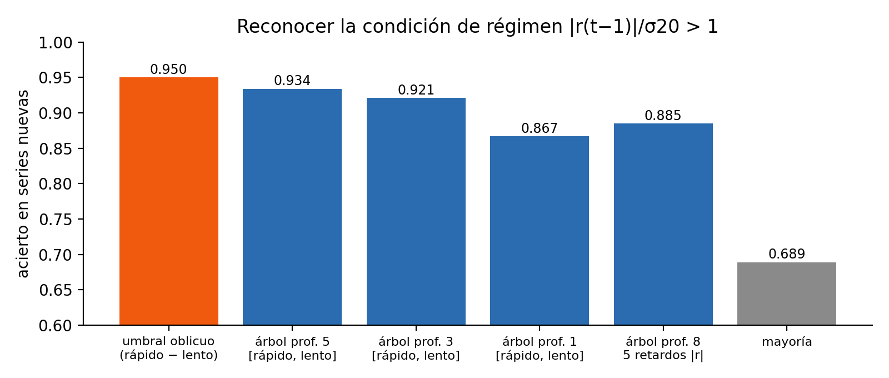

**Figura 12.** Acierto al reconocer la condición de régimen con un umbral oblicuo y con árboles de distinta profundidad. Fuente: elaboración propia [N41].

**Por qué deja de ganar frente a modelos con la misma información.** Si el RF recibe las características multiescala ya calculadas, alcanza y supera a E20-ALB: la ventaja del reservorio era disponer de esos resúmenes, no aportar información nueva. Los estados son **mezclas aleatorias** de esas características y la información útil está distribuida entre unas 2 100 de ellas; los umbrales sobre mezclas son menos eficientes que sobre características limpias. En BTC, además, la señal es mínima, de modo que todos los modelos que ven la historia reciente del precio convergen al mismo techo (AUC ≈ 0,54). Ninguna de las cuatro fuentes de información nuevas lo eleva, y la única que suma algo (los indicadores técnicos) beneficia por igual a E20 y a GBM. Con las entradas agregadas a 2 h y los modelos evaluados, no se observó una ventaja robusta de E20 sobre el aprendizaje automático; **un límite de información es una explicación compatible con los resultados, no un techo demostrado** (N88 probó una sola familia de lecturas; con entrada de 5 minutos E20 tampoco superó a los rivales equiparados y tres cambios de dinámica o lectura no pasaron el cribado, sección 6.3.6).

**¿Cuál es la mejor versión de E20?** Con datos de BTC no hay una respuesta única. E20-ALB tiene el mayor AUC entre las versiones de E20 en 2021–2024 y E20-A0C en 2024–2026, pero en ningún periodo una supera a la otra con significación (sección 6.3.3). Ambas comparten el mismo reservorio TS-LIF y difieren en la lectura (bosque frente a logística) y en la entrada (con o sin indicadores); que se alternen confirma que, en BTC, la información disponible pesa más que la arquitectura. La E20 oficial queda por debajo de ALB en la media de B1–B2, pero no en el periodo reciente R (0,5374 frente a 0,5359); las diferencias por bloque no establecen un orden constante. En la práctica, E20-ALB es la opción más robusta (definida antes de ver los datos reales, mejor en los bancos sintéticos y con el mayor AUC de E20 en el periodo independiente) y E20-A0C la mejor variante cuando se dispone de indicadores técnicos.

**La predictibilidad decae.** Todos los modelos pierden entre 0,02 y 0,04 de AUC entre 2021–2024 y 2024–2026. Es coherente con el decaimiento ya observado a 15 minutos (sección 6.3.1) y con un mercado que se vuelve más eficiente a medida que madura; implica que cualquier modelo de este tipo debe reentrenarse y vigilarse en el tiempo.

**Relación con el artículo de TS-LIF.** Los resultados son coherentes con el análisis teórico de Feng et al. (2025): la neurona separa escalas temporales. En los conjuntos de datos del artículo, con estacionalidad fuerte, esa separación aporta información difícil de obtener de otro modo. En BTC, donde la única estructura explotable está en resúmenes de muy corto plazo, separar escalas equivale a calcular medias móviles e indicadores, algo que también hace la ingeniería de características. Este trabajo no contradice el artículo: **acota su alcance** a series con estructura multiescala.

**Comparación con la literatura.** Los resultados coinciden con Baquero (2026), Sánchez Zurdo (2022) y Kraehenbuehl y Osterrieder (2022): no hay señal diaria de dirección y los efectos a corto plazo son pequeños. Matizan a Sharma et al. (2025) y Kenny (2020): los reservorios pueden ser competitivos, pero cuando se evalúa la **dirección** frente a rivales con la misma información no los superan. Son coherentes con Audrino y Chassot (2024): un modelo simple bien especificado es difícil de batir y el protocolo pesa tanto como el modelo. El acierto selectivo de 3 a 4 puntos es del mismo orden que el filtrado por confianza descrito en estudios de trading con aprendizaje automático (Jaquart et al., 2022) y, como en ellos, no implica rentabilidad sin modelar los costes.

**Respuesta a las hipótesis.**

**Tabla 21.** Respuesta a las hipótesis.

| Hipótesis | Resultado |
|---|---|
| H1: señal en BTC 2 h | **Se cumple:** AUC 0,536 frente a un mínimo detectable de 0,515; placebo 0,498 |
| H2: E20-ALB − RF(U) ≥ +0,010 | **No se cumple:** +0,0065 [+0,0013; +0,0121] (sí en ETH: +0,0115) |
| H3: empate con GBM y logística | **Se cumple:** −0,0015 y −0,0005, IC con el cero |
| H4: la atención no aporta | **Se cumple:** E20-ALB superior en sintéticos y empatada en BTC |
| Mejor versión de E20 en BTC (N87) | **Sin ganador claro:** E20-ALB mayor AUC en 2021–2024 (0,570), E20-A0C en 2024–2026 (0,546); empatan entre sí; ML con indicadores ligeramente por encima |
| N89: E20 con entrada de 5 min supera a los rivales de secuencia / a GBM 2 h | **No se cumplen:** −0,0028 y −0,0004; la lectura temporal mejoró el sintético (+0,040), no pasó el cribado B0 (+0,0007) y no se evaluó en B1–B2 (N90–N91) |

---

## 7. Conclusiones

Este trabajo se propuso determinar si una red de reservorio con neuronas TS-LIF aporta información sobre la dirección de Bitcoin que no capten los modelos de aprendizaje automático con la misma información. Para ello se desarrolló E20-ALB a partir de la línea de investigación previa del autor y se evaluó con un protocolo preregistrado.

En relación con el **primer objetivo**, el protocolo resultó válido: los placebos y la señal nula dieron AUC en torno a 0,50 y los controles positivos se recuperaron (0,70). En relación con el **segundo**, la ablación de MDHS-SNN identificó la entrada escalar idéntica para todas las neuronas y la normalización móvil como causas de su bajo rendimiento; corregidas, el control positivo subió del 57,8 % al 66,0 %, igual que una TCN. Apagar la recurrencia y leer los estados con un bosque aleatorio añadió entre 0,02 y 0,03 de AUC en datos sintéticos.

Respecto al **tercer objetivo**, E20-ALB es el mejor modelo del banco sintético (AUC medio 0,741 frente a 0,731 del bosque aleatorio) y supera a la variante con atención TIA-LIF incluso cuando esta recibe cinco veces más entrenamiento. En BTC a 2 horas, sin embargo, empata con gradient boosting, la regresión logística y TIA-LIF (0,536 frente a 0,537–0,539) y solo supera ligeramente al bosque aleatorio (+0,0065), por debajo del umbral preregistrado. En dos periodos anteriores e independientes de BTC (2021–2024), E20-ALB fue la versión de E20 con mayor AUC (0,570), empatada con E20-A1 y con la variante con indicadores E20-A0C; esta es la mejor en el periodo más reciente (0,546), pero su mejora no se confirmó con $C$ fijo, y en 2021–2024 el aprendizaje automático con indicadores quedó ligeramente por encima de todas las versiones de E20. En cuanto al **cuarto**, la dirección de BTC solo es predecible entre 1 minuto y 2 horas, con el máximo a 2 horas, y no a 4 horas o más. El **quinto objetivo** mostró que el patrón se repite en BTC a 1 hora, ETH y PAXG a 2 horas, que no hay señal diaria en cinco mercados tradicionales y que ninguna fuente de información nueva eleva el techo de forma confirmada; con la secuencia de 5 minutos dentro de cada barra E20 tampoco superó a los rivales equiparados, y tres cambios de dinámica o lectura derivados de la teoría no pasaron el cribado, aunque la lectura temporal sí funciona en datos sintéticos. Por último, respecto al **sexto**, E20-ALB cuesta unas 2,9 veces menos que la E20 oficial, y el análisis matemático muestra que la neurona TS-LIF calcula de forma nativa un comparador «rápido − lento», lo que explica cuándo el reservorio supera a un bosque con entradas estándar y por qué deja de hacerlo frente a características multiescala explícitas.

La conclusión general es que una red de reservorio con neuronas TS-LIF **extrae señal real de la dirección de BTC a 1–2 horas, iguala a los mejores modelos de aprendizaje automático con un coste de entrenamiento mínimo y supera a la variante con atención en datos con estructura conocida, pero no supera a los modelos que reciben la misma información**; un límite de información en el precio es la explicación más compatible con estos resultados, aunque no un techo demostrado. La comparación con TIA-LIF en BTC no aísla la arquitectura porque sus entradas difieren (recibió también el volumen). Este resultado neutral es informativo: delimita qué puede aportar una neurona multiescala en series financieras y deja un protocolo reproducible, con datos sellados y una prueba final definida, para evaluar propuestas futuras con el mismo rigor.

---

## 8. Limitaciones y perspectivas de futuro

En este capítulo se exponen las limitaciones del trabajo y las líneas que se proponen para continuarlo.

- **Evidencia de desarrollo.** Los datos de BTC a 2 horas se habían usado en estudios previos del proyecto y los bloques reservados anteriores ya se consumieron. Por eso se define una **prueba final congelada** (Apéndice C): E20-ALB y sus rivales, sin ningún cambio, en SOL, BNB y XRP a 2 horas, activos no utilizados en ningún análisis a esa escala, con una **prueba de equivalencia** de margen ±0,010.
- **Comparaciones múltiples.** En el programa experimental de octubre se preregistraron 22 hipótesis y se cumplieron 8, casi todas de control; ninguna de superioridad sobre gradient boosting o la regresión logística. En la fase de alta frecuencia (N89–N91) se fijaron ocho contrastes, dos condicionales no se ejecutaron, y solo se cumplió la de mecanismo en datos sintéticos; el bloque de cribado 2019–2021 solo sirve para descartar candidatas, no para confirmarlas. La prueba final se ejecutará una sola vez.
- **Potencia limitada.** Con 11 000 barras de 2 horas, el error estándar de la diferencia pareada de AUC es de unas 0,003: se detectan diferencias de al menos 0,008 con una potencia del 80 %. Detectar 0,005 exigiría unas 31 000 barras (unos 7 años). Para una diferencia pareada de +0,010, 2 000 barras nuevas son insuficientes (diferencia mínima detectable ≈ 0,018); la enmienda N89 fija un único análisis de **confirmación hacia adelante** tras 8 000 barras válidas nuevas de BTC a 2 h (≈ 1,8 años), sin parada opcional.
- **Pocas semillas y rivales incompletos a 2 horas.** Se usaron 4 semillas en BTC a 2 horas, 2 en ETH y 1 en BTC a 1 hora; MLP, LSTM y TCN solo se evaluaron en datos sintéticos y deben repetirse a 2 horas con el protocolo final.
- **Diferencias de entrada y de hardware.** TIA-LIF recibió volumen real en BTC y los demás modelos solo retornos; la misma semilla de TIA-LIF dio 0,5349 en GPU y 0,5360 en CPU.
- **No hay una única mejor versión de E20 en BTC y la señal decae.** E20-ALB y E20-A0C se alternan según el periodo y la predictibilidad baja de 0,56–0,58 (2021–2024) a 0,53–0,55 (2024–2026). Conviene evaluar con ventanas móviles y reentrenar periódicamente; la prueba final incluye ambas versiones.
- **Vulnerabilidad a cambios de volatilidad.** E20-ALB falla en el 44 % de las realizaciones con cambio de régimen inducido. Una línea futura directa es incorporar a E20-ALB una normalización causal de la entrada por la volatilidad reciente.
- **Información distinta del precio.** Si, como sugieren los resultados, el límite es de información, la vía para mejorar no es la arquitectura sino nuevos datos: volatilidad implícita del mercado de opciones o microestructura con historia larga.
- **Otros objetivos.** La volatilidad («habrá un movimiento grande») sí tiene estructura (AUC ≈ 0,64 en BTC a 2 horas) y es un candidato natural para una neurona multiescala.
- **Hardware neuromórfico.** El contador de eventos mide operaciones, no energía; traducirlo a energía real requiere ejecutar la red en un chip neuromórfico.

---

## Lista de acrónimos

| Acrónimo | Significado |
|---|---|
| A0 / A1 | E20 con recurrencia / sin recurrencia |
| ALB | lectura de bosque aleatorio sobre los estados de E20-A1 (*Apagada-recurrencia + Lectura Bosque*) |
| AUC | área bajo la curva ROC |
| BTC / ETH / PAXG | Bitcoin / Ether / Pax Gold (oro tokenizado) |
| CART | árbol de clasificación y regresión |
| ESN | red de estado de eco (*echo state network*) |
| FRED | base de datos económica de la Reserva Federal de San Luis |
| GBM | gradient boosting (por histogramas) |
| HAR | modelo autorregresivo heterogéneo de volatilidad realizada |
| IAAFT | transformada de Fourier ajustada iterativamente en amplitud (generación de nulos) |
| IC95 | intervalo de confianza del 95 % |
| iSTDP | plasticidad inhibitoria dependiente del instante de disparo |
| LIF | integración y disparo con fuga (*leaky integrate-and-fire*) |
| LOGIT | regresión logística |
| LSM | máquina de estado líquido (*liquid state machine*) |
| LSTM | memoria a largo y corto plazo |
| MAC | multiplicación-acumulación |
| MDHS-SNN | *Multi-scale Dual-compartment Heterogeneous Sparse SNN* (red original del autor) |
| MLP | perceptrón multicapa |
| OOB | fuera de bolsa (*out-of-bag*) |
| RF | bosque aleatorio (*random forest*) |
| SNN | red neuronal espigante (*spiking neural network*) |
| STDP | plasticidad dependiente del instante de disparo |
| TCN | red convolucional temporal |
| TIA-LIF | red TS-LIF con atención temporal (red previa del autor) |
| TOST | dos pruebas unilaterales (prueba de equivalencia) |
| TS-LIF | *Temporal Segment LIF*: neurona de dos compartimentos (Feng et al., 2025) |
| U / C / IND | 10 entradas estándar / canales multiescala / 62 indicadores técnicos |

---

## Referencias bibliográficas

> Norma APA (7.ª ed.), orden alfabético. Las referencias están fichadas con su PDF en `TFM/REFERENCIA BIBLIOGRAFICA` o en `teorias_resumenes`; las clásicas o externas se verificaron el 05-10-2026 frente a su ficha editorial (DOI, PMLR o Project Euclid).

- Akyildirim, E., Goncu, A., & Sensoy, A. (2021). Prediction of cryptocurrency returns using machine learning. *Annals of Operations Research, 297*, 3–36. https://doi.org/10.1007/s10479-020-03575-y
- Audrino, F., & Chassot, J. (2024). *HARd to beat: The overlooked impact of rolling windows in the era of machine learning* (arXiv:2406.08041). arXiv.
- Baquero, C. (2026). *Bitcoin price prediction: Peer-reviewed evidence and social media discourse* (arXiv:2606.00071). arXiv.
- Berger, T., & Koubová, J. (2024). Forecasting Bitcoin returns: Econometric time series analysis vs. machine learning. *Journal of Forecasting, 43*(7), 2904–2916. https://doi.org/10.1002/for.3165
- Breiman, L. (2001). Random forests. *Machine Learning, 45*(1), 5–32. https://doi.org/10.1023/A:1010933404324
- Domingo Colomer, L. (2023). *Classical and quantum reservoir computing: Development and applications in machine learning* [Tesis doctoral, Universidad Politécnica de Madrid]. arXiv:2310.07455.
- Ezinwoke, B., & Rhodes, O. (2025). *Predicting price movements in high-frequency financial data with spiking neural networks* (arXiv:2512.05868). arXiv.
- Feng, S., Feng, W., Gao, X., Zhao, P., & Shen, Z. (2025). TS-LIF: A temporal segment spiking neuron network for time series forecasting. En *International Conference on Learning Representations (ICLR 2025)*.
- Friedman, J. H. (2001). Greedy function approximation: A gradient boosting machine. *The Annals of Statistics, 29*(5), 1189–1232. https://doi.org/10.1214/aos/1013203451
- Gao, K., Luk, W., & Weston, S. (2021). High-frequency trading and financial time-series prediction with spiking neural networks. *Wilmott Magazine*, 20–32. (verificar el número de edición antes del depósito)
- García-Ramos Lucero, M. Á. (2023). *La conceptualización de las criptomonedas como un asset class: consideraciones económicas y jurídicas* [Tesis doctoral, Universidad Camilo José Cela].
- He, Y. (2023). *Reservoir computing in alpha forecasting of foreign exchange market* [Tesis de máster, Imperial College London].
- Hernández Hernández, C., & Forero Criollo, J. S. (2023). *Modelos de predicción estocástica para Bitcoin: una evaluación de métodos y desempeño* [Trabajo de grado de maestría, Universidad EAFIT].
- Jaeger, H. (2001). *The "echo state" approach to analysing and training recurrent neural networks* (GMD Report 148). German National Research Center for Information Technology.
- Jaquart, P., Köpke, S., & Weinhardt, C. (2022). Machine learning for cryptocurrency market prediction and trading. *The Journal of Finance and Data Science, 8*, 331–352. https://doi.org/10.1016/j.jfds.2022.12.001
- Kenny, M. (2020). *Investigating the predictability of a chaotic time-series data using reservoir computing, deep-learning and machine-learning on the short-, medium- and long-term pricing of Bitcoin and Ethereum* [Tesis de máster, Technological University Dublin]. https://doi.org/10.21427/42ks-q868
- Kraehenbuehl, M., & Osterrieder, J. (2022). *The efficient market hypothesis for Bitcoin in the context of neural networks* (arXiv:2208.07254). arXiv.
- Künsch, H. R. (1989). The jackknife and the bootstrap for general stationary observations. *The Annals of Statistics, 17*(3), 1217–1241. https://doi.org/10.1214/aos/1176347265
- Lakens, D. (2017). Equivalence tests: A practical primer for t tests, correlations, and meta-analyses. *Social Psychological and Personality Science, 8*(4), 355–362. https://doi.org/10.1177/1948550617697177
- Li, Q., Mukhopadhyay, C., Bayat, A., & Habibnia, A. (2025). *Quantum reservoir computing for realized volatility forecasting* (arXiv:2505.13933). arXiv.
- López-García, A. (2023). Análisis comparativo de redes neuronales profundas para la predicción del precio de mercado de Bitcoin. *Rect@, 24*, 1–16. https://doi.org/10.24309/recta.2023.24.1.01
- Lv, C., Wang, Y., Han, D., Zheng, X., Huang, X., & Li, D. (2024). Efficient and effective time-series forecasting with spiking neural networks. En *Proceedings of the 41st International Conference on Machine Learning* (PMLR, Vol. 235, pp. 33624–33637).
- Maass, W., Natschläger, T., & Markram, H. (2002). Real-time computing without stable states: A new framework for neural computation based on perturbations. *Neural Computation, 14*(11), 2531–2560.
- Sabbella, H., Mukherjee, A., Kandappu, T., Dey, S., Pal, A., Misra, A., & Ma, D. (2025). *The promise of spiking neural networks for ubiquitous computing: A survey and new perspectives* (arXiv:2506.01737). arXiv.
- Sánchez Zurdo, I. (2022). *La capacidad predictiva de las redes neuronales LSTM respecto del Bitcoin* [Trabajo de fin de grado]. (completar universidad y enlace del repositorio)
- Sharma, M., Sartor, E., Cavazza, M., & Prendinger, H. (2025). *Echo state networks for Bitcoin time series prediction* (arXiv:2508.05416). arXiv.
- Shen, Z., Wan, Q., & Leatham, D. J. (2021). Bitcoin return volatility forecasting: A comparative study between GARCH and RNN. *Journal of Risk and Financial Management, 14*(7), 337. https://doi.org/10.3390/jrfm14070337
- Vogels, T. P., Sprekeler, H., Zenke, F., Clopath, C., & Gerstner, W. (2011). Inhibitory plasticity balances excitation and inhibition in sensory pathways and memory networks. *Science, 334*(6062), 1569–1573.
- Walugembe, F. N., Wielgosz, M., Mertik, M., & Gams, M. (2026). Bio-inspired spiking recurrent networks with evolutionary optimization for non-stationary cryptocurrency forecasting. *Big Data and Cognitive Computing, 10*(7), 200. https://doi.org/10.3390/bdcc10070200
- Zhang, H., & Vargas, D. V. (2023). A survey on reservoir computing and its interdisciplinary applications beyond traditional machine learning. *IEEE Access*. https://doi.org/10.1109/ACCESS.2023.3299296

---

## Apéndice A. Registro de preregistros y resultados

La bitácora completa está en `plans/PLAN_NOCHE_E20_REAL_v1.md` (rama `experiment/e20-plasticidad-estructural-v1` del repositorio del proyecto, carpeta de trabajo `TIA LIF MEJORADO/e20-puntos-debiles-v1`). Cada entrada «PRE-REGISTRO» se versionó antes de ejecutar y cada «ADENDA» o «RESULTADO» recoge lo obtenido. El resumen del programa del 3–4 de octubre de 2026 está en `plans/RESUMEN_FINAL_NOCHE_20261004.md` y la contabilidad de hipótesis en `plans/DEFLACION_COMPARACIONES_NOCHE.md`.

| Adenda | Contenido | Sección |
|---|---|---|
| Ablación MDHS (2026-09-25) | MDHS-SNN → E20 | 6.2.1 |
| Estudio multiescala (2026-09-26) | 13 escalas temporales | 6.3.1 |
| Auditoría TIA-LIF (2026-09-23) | fuga $t+1$ | 6.3.10 |
| N31–N35 | lectura de bosque (E20-ALB): desarrollo y confirmación | 6.2.2 |
| N34, N39, N41, N44, N47, N59 | límites, representación distribuida, análisis matemático, número de variables, regla lineal, cambio de volatilidad | 6.2.3, 6.2.4, 6.4 |
| N63, N65, N67, N68 | reloj, BTC 2 h, BTC 1 h, ETH 2 h | 6.3.2, 6.3.4 |
| N69 | coste computacional | 6.3.9 |
| N54, N71–N76 | calendario, ETH, financiación, flujo de órdenes | 6.3.5 |
| N79–N80a | E20 frente a TIA-LIF | 6.2.5, 6.3.11 |
| N81–N86 | indicadores técnicos y E20-A0C | 6.3.5 |
| N83 | mercados tradicionales diarios | 6.3.7 |
| N84 | PAXG 2 h | 6.3.4 |
| N87 | confirmación en periodos anteriores de BTC; mejor versión de E20 | 6.3.3 |
| N88 | lectura híbrida (estados + entradas limpias) a 2 h | 6.4 |
| N89–N91 | entrada de 5 min, lectura temporal y modificaciones de la neurona (sintético, B1–B2 y bloque de cribado 2019–2021) | 6.3.6 |

Etiquetas de git principales: `e20-noche-n31-prereg`, `e20-noche-n35-confirmacion`, `e20-noche2-btc2h-prereg`, `e20-tialif-n80-final`, `e20-ind2h-n82-resultado`, `e20-mercados-trad-n83-resultado`, `e20-n86-resultado`, `e20-n87-prereg`, `e20-n87-resultado`, `e20-n88-resultado`, `e20-n89op-prereg`, `e20-n89-enmienda2`, `e20-n90-prereg`, `e20-n90-s-resultado`, `e20-n91-prereg`, `e20-n91-b0-resultado`, `e20-lecciones-20261004`; versión base de E20: `mdhs-e20-v2-2026-09-27`.

## Apéndice B. Reproducibilidad

| Elemento | Ubicación |
|---|---|
| Simulador (preset E20, variables opcionales) | `code/mdhs_snn_predictor.py` |
| Lectura de bosque (E20-ALB) | `code/temp_scripts/e20real_lectura_rf.py` |
| Series de 1 h y 2 h con sellado y manifiesto sha256 | `code/temp_scripts/e20bt_intra_datos.py`; `logs_ind/e20_pd/btc_intradia/manifest_datos_2026-10-04.json` |
| Análisis de BTC a 2 h (pares e intervalos) | `code/temp_scripts/e20btc_intra_analisis.py` |
| E20 frente a TIA-LIF | `code/temp_scripts/e20_vs_tialif.py`, `tialif_lanzar.py` |
| Indicadores técnicos | `code/temp_scripts/e20btc_indicadores2h.py`, `e20btc_ind_canales.py` |
| Mercados de FRED | `code/temp_scripts/mercados_fred_descarga.py`, `mt_series.py`, `mt_analisis.py` |
| Estudio multiescala | `code/temp_scripts/multi_tf_direccion.py`; resultados en `logs_ind/multi_tf_direccion.csv` |
| Métricas oficiales | `code/snn_modules/metricas_oficiales.py` |
| Contador de eventos | `code/snn_modules/energy_meter.py` |
| Entorno | Python 3.9 (`PYTHON_LIBRERIAS_INSTALADAS.txt`), Windows 11, CPU de 22 núcleos |
| Figuras de esta memoria | generadas desde las cifras de las adendas citadas y el CSV multiescala |

Los estados del reservorio (3 001 por paso) se vuelcan con `SNN_STATE_DUMP=<carpeta>` y el preset E20; `SNN_W_GAIN=0` produce la variante A1.

## Apéndice C. Protocolo de la prueba final congelada

**Prueba de transferencia (SOL, BNB y XRP): debe versionarse con un commit y una etiqueta antes de descargar los datos; pendiente de ejecutar.** La confirmación hacia adelante en BTC, descrita al final de este apéndice, ya está versionada.

- **Datos:** SOL/USDT, BNB/USDT y XRP/USDT a 2 horas (Binance, velas alineadas a la hora par UTC), desde su inicio hasta la fecha de congelación. Antes de ejecutar se comprobará en la bitácora que ninguna de estas series a 2 horas se ha usado en ningún análisis.
- **Modelos congelados:** E20-ALB (principal), E20-A0C (indicadores como canales, logística $C=10^{-3}$), E20 oficial, E20-A1 + logística, GBM(U+C), GBM(U+C+IND), LOGIT(U), LOGIT(U+C+IND), RF(U), MLP y LSTM, con los hiperparámetros de esta memoria y sin ningún ajuste.
- **Partición y estadística:** 70 % / 30 % cronológica; 4 semillas de red; IC por bootstrap de bloques de 60 barras emparejado.
- **Hipótesis:** HF1, AUC(E20-ALB) > 0,5 con IC95 inferior > 0,5 en al menos 2 de los 3 activos; HF2 (equivalencia), el IC90 de AUC(E20-ALB) − AUC(GBM(U+C)) dentro de ±0,010 en al menos 2 de los 3; HF3, AUC(E20-ALB) − AUC(RF(U)) ≥ +0,010 con IC95 > 0 en al menos 2 de los 3.
- **Potencia esperada:** con unas 8 000 barras de prueba por activo, el AUC mínimo detectable es de 0,518.
- **Regla:** se ejecuta una sola vez y los resultados se informan tal cual, cumplan o no las hipótesis.

**Confirmación hacia adelante en BTC.** Además de la prueba de transferencia anterior, el protocolo `plans/PROTOCOLO_CONFIRMACION_FORWARD_v1.md` congela una única evaluación en BTC a 2 horas cuando se reúnan 8 000 barras selladas consecutivas, cerradas y válidas posteriores al 25-09-2026 (enmiendas v1.1 y v1.2, etiqueta `e20-forward-v1-2`): los modelos se entrenan solo con el desarrollo y se evalúan sobre las barras selladas. La familia principal (selección por confianza, empate de E20 con el aprendizaje automático y estructura horaria) mantiene sus reglas; E20-A0C se añade como familia secundaria frente al mejor de GBM y LOGIT con sus mismas entradas (éxito: ΔAUC ≥ +0,010 con IC 97,5 % inferior > 0). El procedimiento se verificó sin tocar datos sellados: reproduce exactamente los análisis de desarrollo cuando el corte coincide, y los estados de la red en un tramo inicial no cambian si se altera el tramo final (invariancia de prefijo).

## Apéndice D. Nomenclatura de los modelos

| Nombre | Definición |
|---|---|
| TS-LIF | neurona de dos compartimentos (dendrita lenta, soma rápido) de Feng et al. (2025) |
| MDHS-SNN | reservorio original del autor: 1 000 neuronas TS-LIF heterogéneas con STDP, iSTDP y ramas DH-LIF |
| E20 | MDHS-SNN tras la ablación: entrada con signo, sin rama D4, canal de amplitud, retardos y escala fija |
| E20 oficial (A0) | E20 con recurrencia + lectura logística $C=3\cdot10^{-5}$ |
| E20-A1 | E20 sin recurrencia |
| **E20-ALB** | **E20-A1 + lectura de bosque aleatorio (300 árboles) sobre los 3 001 estados: modelo propuesto** |
| E20-ALA | E20-A1 + GBM sobre 30 componentes principales con selección adaptativa |
| E20-A0C | E20 oficial + 62 indicadores como canales + logística $C=10^{-3}$: mejor E20 en 2024–2026 (0,546), no confirmada en 2021–2024 (N87) |
| TIA-LIF | neuronas TS-LIF + atención temporal entrenada por retropropagación (versión sin fuga) |

## Apéndice E. Declaración de uso de sistemas de IA

*BORRADOR propuesto para que el autor lo revise, corrija y traslade al modelo «Declaración de uso de sistemas de IA» del Aula (Guía de uso de IA para estudiantes de la VIU). Lo marcado [verificar] debe confirmarlo el autor; la firma y la fecha son personales.*

| Campo | Contenido propuesto |
|---|---|
| Herramientas | Claude Code (Anthropic; modelo Claude Opus 5.5) y Codex CLI (OpenAI; [verificar modelo y versión]), usadas entre septiembre y octubre de 2026 [verificar fechas]. |
| Fases | Programación del simulador, de los análisis y de las pruebas de verificación; redacción y revisión de los pre-registros; ejecución de los experimentos preregistrados; revisión crítica cruzada (Codex revisó pre-registros, código y el texto de esta memoria y Claude verificó cada corrección contra el código y la bitácora); búsqueda y fichado de bibliografía y verificación de referencias; redacción de borradores de los capítulos; generación de figuras y tablas a partir de los registros. |
| Datos introducidos | Código propio, datos de mercado públicos (Binance, FRED) y resultados de los experimentos. Ningún dato personal ni confidencial. |
| Contenido incorporado | Borradores de los capítulos 1 a 8 y de los apéndices; tablas y figuras generadas desde las adendas de la bitácora; el código de los experimentos del repositorio [verificar el alcance exacto]. |
| Decisiones del autor | La elección del problema, del modelo principal y del título; la aprobación de cada pre-registro y de las conclusiones; la decisión de informar los resultados negativos [verificar]. |
| Verificación humana | [A completar por el autor: por ejemplo, revisión de las cifras frente a la bitácora y los registros, de las referencias frente a los PDF o sus fichas editoriales, y lectura crítica del texto completo.] |
| Fecha y firma | [Personal del autor, según el procedimiento de la VIU.] |
